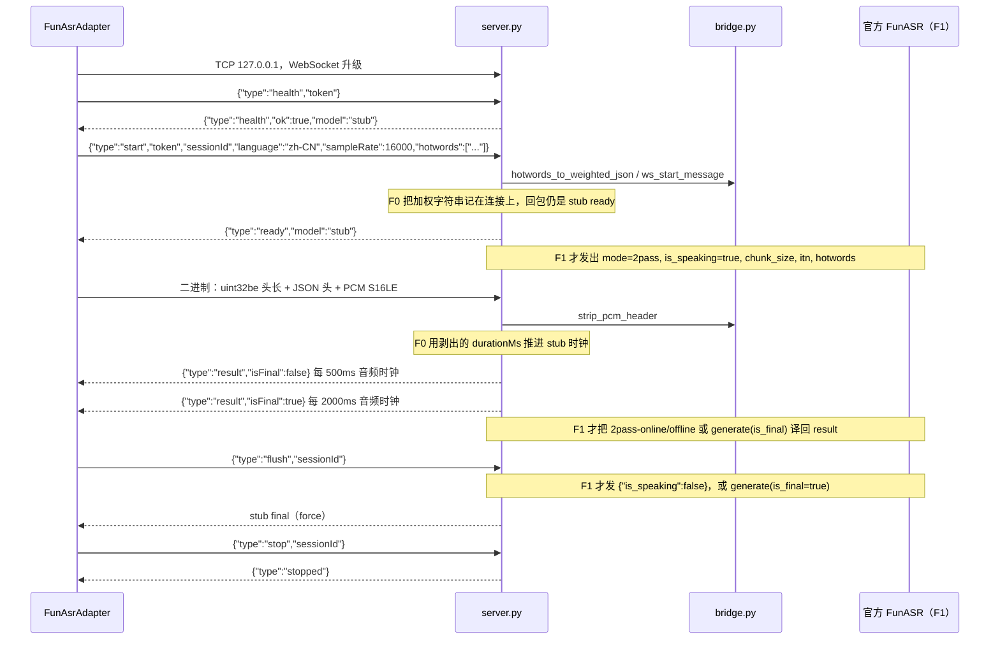

# FunASR 协议桥（F0）

状态：策略 A 已锁定。F0 定义翻译。F1 在 sidecar 内用 CPU 加载 `paraformer-zh-streaming`，主进程方言不变。权重不进 git。

盯播主进程继续说现有 WebSocket 方言。sidecar 对主进程的回包保持骨架行为。官方 FunASR 的字段转换放在 `python/funasr_sidecar/bridge.py`，留给 F1 调用。F1 要加载的模型是 `paraformer-zh-streaming`。F0 不下载、不 import `funasr`。

依据：

- 官方 runtime WebSocket：[websocket_protocol_zh.md](https://github.com/modelscope/FunASR/blob/main/runtime/docs/websocket_protocol_zh.md)
- 盯播客户端帧：`src/main/asr/funasrProtocol.ts`（`encodeAudioMessage`、`FunasrClientMessage`、`FunasrServerMessage`）
- 盯播 sidecar：`python/funasr_sidecar/server.py`（只绑定 `127.0.0.1`，`health` / `start` 校验 token，音频时钟上的 stub `result`）
- 适配器对外接口：`src/main/asr/FunAsrAdapter.ts` 的 `AsrAdapter` 方法。F0 不改这个文件。

## 边界

```text
渲染进程 / 会话
    │  AsrAdapter（start / push / flush / stop / onResult）
    ▼
FunAsrAdapter          ← 对外契约不动，仍只组盯播消息
    │  ws://127.0.0.1  + 一次性 token
    ▼
server.py              ← 对主进程仍说盯播方言。F1 默认加载流式模型；--stub 才回骨架文本
    │  bridge.py       ← F0 纯函数；F1 才把下面两路接到真实推理
    ├─ runtime WebSocket（mode / chunk_size / is_speaking / raw PCM / hotwords / itn）
    └─ AutoModel.generate（paraformer-zh-streaming，chunk_size [0,10,5]，is_final）
```

官方服务常见监听是 `0.0.0.0:10095`，协议里没有盯播 token。这两件事留在 sidecar 内侧：进程仍然拒绝非回环绑定，主进程仍然只连 `127.0.0.1`。音频和热词不出本机。

## 时序

当前线上行为是左列。右列是 F1 在 sidecar 内部要做的翻译，本阶段不发送。



stub 的 partial / final 文案和节奏仍由 `server.py` 的 `PARTIAL_EVERY_MS` / `FINAL_EVERY_MS` 决定。`to_dingbo_result` 不参与这条骨架回包，避免没加载模型时冒充官方识别结果。

## 字段对照

| 盯播（主进程 ↔ sidecar） | 官方 runtime WebSocket | AutoModel（F1，`paraformer-zh-streaming`） |
| --- | --- | --- |
| `health` + `token` | 无对应字段。鉴权停在 sidecar | 不涉及 |
| `start.token` | 不转发 | 不涉及 |
| `start.sessionId` | 首包 `wav_name` | 每个会话单独一份 `cache={}` |
| `start.language = "zh-CN"` | 不单列。`svs_lang` 只属于 SenseVoiceSmall | 该流式模型走中文 Paraformer，不把 `zh-CN` 写成 `svs_lang` |
| `start.sampleRate = 16000` | `audio_fs: 16000`。官方也接受 8000，适配器不发 8000 | 输入 16 kHz |
| `start.hotwords: string[]` | `hotwords` 的值是加权 JSON **字符串** | 见下方热词。本助手不把该字符串当作 `generate(hotword=)` |
| 首包控制 | `mode: "2pass"`，`is_speaking: true`，`wav_format: "pcm"`，`chunk_size: [5,10,5]`，`itn: true` | `chunk_size: [0,10,5]`，`encoder_chunk_look_back: 4`，`decoder_chunk_look_back: 1` |
| 二进制音频 | 去掉盯播头之后的 raw PCM bytes | F1 再把 S16LE 转成 float32 波形。F0 只剥头 |
| `flush` | `{"is_speaking": false}`，连接保持，便于下一句再发 `is_speaking: true` | 当前句最后一次 `generate(..., is_final=true)` |
| `stop` | 同样先发 `{"is_speaking": false}`，然后关闭盯播套接字 | 丢掉该会话的 `cache` |
| 只绑定 `127.0.0.1` | 官方示例常写 `0.0.0.0`。sidecar 继续拒绝其他 host | 进程内调用，不再开官方端口 |

`ws_start_message` 固定 runtime 那组 `chunk_size`。`automodel_generate_kwargs` 固定 AutoModel 那组。两组数字不能互换：

- runtime 文档：`[5,10,5]` 表示当前音频 600ms，回看 300ms，前看 300ms（单位 60ms）。
- AutoModel 流式示例：`[0,10,5]` 表示上屏粒度 `10*60=600ms`、未来信息 `5*60=300ms`；步长 `10*960=9600` 个 16 kHz 采样点。`encoder_chunk_look_back=4` 和 `decoder_chunk_look_back=1` 是示例参数，不是 wrapper 的源码默认值。

F1 走进程内 AutoModel 时调用后者。只有将来改接官方 runtime 服务时才发送前者。

## 热词

盯播 `hotwords` 来自话术框架关键词，类型是 `string[]`（`AsrStartConfig`，最多由会话层截到 80 个）。官方 runtime 要的是字符串，内容为 JSON 对象，权重是正整数。文档示例是 `{"阿里巴巴":20,"通义实验室":30}`，并注明权重只在 FST 热词服务下生效。

`hotwords_to_weighted_json` 的规则：

- 缺省或空数组 → `"{}"`
- 去掉首尾空白，丢掉空串，重复词保留第一次的顺序
- 列表共用一个权重，默认 20。盯播没有逐词权重
- 返回值是紧凑 JSON 文本（`ensure_ascii=False`，中文不转 `\u`）
- 放进官方文本帧时，`hotwords` 字段的 JSON 类型是 string。再 `json.loads` 一次才得到权重对象

AutoModel 各模型的热词入口不一样（有的是空格分隔的 `hotword` 字符串，有的是 `hotwords` 列表）。`paraformer-zh-streaming` 不会自动吃 runtime 那份加权字符串。F0 只锁定 WS 字段。F1 若要做热词，另选该模型实际接受的参数，不要把加权字符串原样塞进 `generate`。

## 音频帧

盯播二进制帧（`encodeAudioMessage` 与 `server.py` 原先的解析一致）：

```text
uint32be header_length | UTF-8 JSON header | PCM S16LE
header = {"type":"audio","sessionId","seq","startMs","durationMs"}
```

一帧 20ms、16 kHz、单声道、S16LE，是 320 个采样、640 字节。官方 runtime 要求发送去掉头部后的 bytes。`strip_pcm_header` 返回 `(header, pcm)`。`durationMs` 仍由 sidecar 解释：有头里的时长就用它，否则按 PCM 字节估算。非法长度或非对象头按协议错误处理；截断的 JSON 仍按原来的方式结束该连接。

## 结果：online / offline → `isFinal`

盯播 `result` 的形状保持 `funasrProtocol.ts` 里的 `FunasrServerMessage`：

```text
type, sessionId, providerResultId, startMs, endMs, text, isFinal, confidence?
```

`to_dingbo_result` 只写这些字段。`mode`、`wav_name`、`timestamp`、`stamp_sents`、官方 `is_final` 都不出现在盯播回包里。`FunAsrAdapter.onSocketMessage` 因此继续按原样拷进 `AsrResult`。

`isFinal` 的规则：

| 来源 | 盯播 `isFinal` |
| --- | --- |
| `mode` 为 `online` 或 `2pass-online` | `false` |
| `mode` 为 `offline` 或 `2pass-offline` | `true` |
| AutoModel：本次 `generate` 的 `is_final=false` | `false` |
| AutoModel：本次 `generate` 的 `is_final=true`（末块或 flush） | `true` |

官方结果里的 `is_final` 表示「识别是否结束」。实时示例里 `2pass-online` 也可以带 `is_final: true`；离线文档写明 offline 模式下该字段恒为 `false`，因为服务端只回一次。盯播的 `isFinal` 表示这段文本是否已经提交。桥按 `mode` 或按调用 `generate` 时传入的布尔值决定，不复制官方 `is_final`。两边同时给出则直接报错。

`startMs` / `endMs` 用盯播音频时钟（帧头里的时间，或 sidecar 累计的 `audio_ms`）。官方 `timestamp` 是模型字级时间，常常还是字符串，不拿来当会话时钟。`providerResultId` 由调用方生成，官方消息里没有这个 id。

AutoModel `generate` 的返回值按官方示例是对象数组，文本在 `text`。多个对象的 `text` 按顺序拼成一条盯播 `text`。

## F0 已经接上的部分

`server.py` 在不改变 stub 回包的前提下调用了两处纯函数：

- `start` 时把 `hotwords` 译成加权字符串，放在连接的 `funasr_hotwords`。坏输入得到 `"{}"`，`ready` 仍是 `model: "stub"`。
- 二进制帧用 `strip_pcm_header` 取头和 PCM，随后仍按 500ms / 2000ms 音频时钟发「未加载模型」的 partial / final。

`ws_start_message`、`ws_end_message`、`automodel_generate_kwargs`、`to_dingbo_result` 有测试，进程内没有调用官方服务。

## F1 已在 sidecar 里做的事

`engine.py` 在 `--stub` 关闭时加载 `paraformer-zh-streaming`，`device="cpu"`。`import funasr` 发生在 `load_cpu_model` 里面，测试默认不走这条路径。

- 缓存默认 `~/.cache/modelscope`。`FUNASR_CACHE_DIR` 或 `--cache-dir` 可以改，但目录在仓库内会直接拒绝。
- 每个盯播会话一份 `cache`。音频按 600ms / 19200 字节调用 `automodel_generate_kwargs`，再用 `to_dingbo_result` 回盯播 `result`。
- `paraformer-zh-streaming` 每个块返回的是新的一段文本，不会改写前一块。盯播缓冲同时只保留一条 partial，所以非空块都落成 `isFinal: true`，否则直播中途分析看不到已经识别的字。`flush` 仍用模型的 `is_final=true` 冲刷句尾。这不是第二遍 offline 纠错。`stop` 丢掉会话。
- `health` / `ready` 的 `model` 在加载成功后是 `paraformer-zh-streaming`，`detail` 里也写这个 id。加载中或失败时 `ok: false`，并且不会回放骨架句子。
- `--stub` 或 `FUNASR_SIDECAR_STUB=1` 保持 F0 骨架，供 `pnpm test` 使用。

热词加权字符串仍然只记在连接上。`paraformer-zh-streaming` 不消费 runtime 那份 JSON，F1 不把它塞进 `generate`。GPU 和第二遍 offline 模型不在这一步。

`FunAsrAdapter` 的方法签名不变。产品路径默认拉起真实模型；单测传入 `stub: true`。`start` / `health` 的等待时间在真实模型下放到 10 分钟，端口监听仍是 5 秒。

## 展示层标点

`punctuate` 是同一条回环 WebSocket 上的文本帧，沿用 `start` 之后的令牌，不把令牌再写进这一帧。它不产生 `AsrResult`。

```json
{ "type": "punctuate", "requestId": "…", "sessionId": "…", "text": "今天天气不错", "mode": "realtime", "reset": false }
{ "type": "punctuated", "requestId": "…", "ok": true, "text": "今天天气不错。", "mode": "realtime", "detail": "" }
```

- `mode` 为 `realtime` 或 `offline`。实时调用复用该连接上的同一份 cache。可选 `cache` 对象只给测试或外部 JSON 状态；真实模型的 cache 留在进程里，响应不回传。
- `reset: true` 清掉这份 cache。识别重连后的下一次请求会带上。
- 块首标点属于上一块，实现不得 strip。
- 实时模型 `iic/punc_ct-transformer_zh-cn-common-vad_realtime-vocab272727`。离线模型 `ct-punc` 只在本机权重目录已经存在时加载。
- `--stub` 回 `ok: false`、原文和 `未加载标点模型`。健康检查不会为了标点去下载权重。
- 加载放在第一次 `punctuate` 的后台线程。还没好时立即回「标点模型加载中」，不堵住音频结果。
