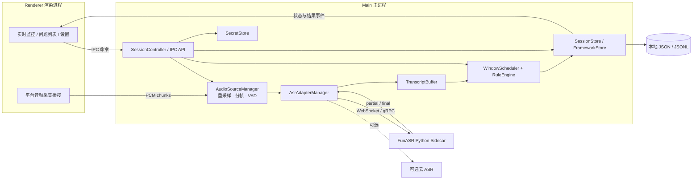
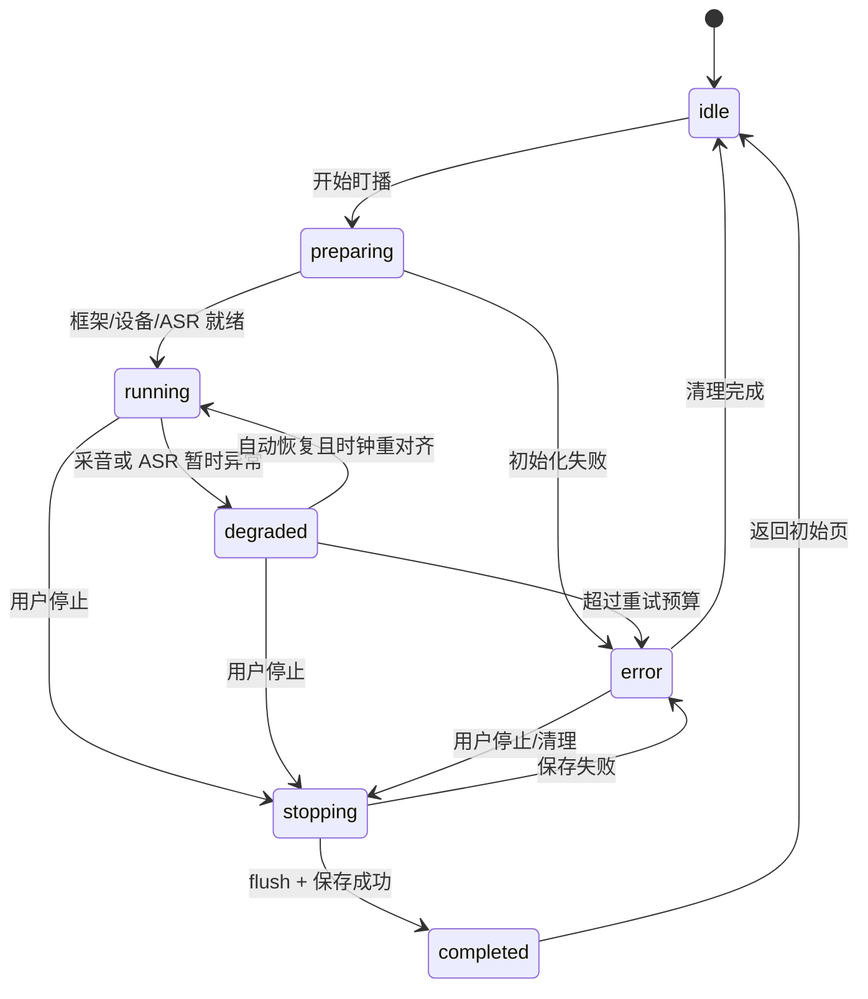

# AI盯播 · 软件设计文档（SDD）

| 字段 | 值 |
|------|-----|
| 版本 | **v1.0.0** |
| 状态 | Draft（对齐 PRD v1.0.0 工作稿。已交付行为以 main 代码为准：M1–M4 代码项、成句 / 软切 / 周期标点、回看与场次目录、M5 双端核心、PR #22 角色校验。人工验收未完成。M6 出站与 M7 未实现。PR #23 M6.1 为草稿，未合 main。tag `sdd-v1.0.0` 未打，不复制 `versions/`） |
| 日期 | 2026-10-20（Asia/Shanghai） |
| 对齐需求 | **PRD v1.0.0**（`docs/prd/latest.md`，本分支工作稿） |
| 适用范围 | 本人自用的 Windows / macOS 桌面应用；场景方向为抖音直播；音源为本机环回或抖音直播间链接（隐藏播放窗 + WebAudio 旁路） |
| 负责人 | AI盯播项目经理 |

> 工作稿路径：`docs/sdd/latest.md`。版本规则见 `docs/sdd/README.md`。定版时更新 `docs/CHANGELOG.md`，打 git tag `sdd-vX.Y.Z`，并把当时的 `latest.md` 完整复制为 `docs/sdd/versions/vX.Y.Z.md`。本轮不打 tag，不复制 `versions/`。`versions/v0.3.0.md` 仍是冻结快照。
>
> 【本次更新】2026-10-20：对齐 PRD v1.0.0 Draft 的门禁补强。只扩展 §1.1 的模块边界与不适用项。角色校验仍按 PR #22 已合来写，不恢复「共用完整 preload」。
>
> 【本次更新】2026-10-20（裁定）：中控推流 / 发券提醒控件属 PRD v1.0.0，要画，不把空位当目标。触发逻辑可依赖未合的 PR #23。OBS / webhook 出站仍后置。main 上尚未画出，不写成已交付。
>
> 【本次更新】2026-10-21：新增抖音直播流音源（ADR-017）。直播页在独立分区的隐藏窗里播放，preload 用 WebAudio 旁路把声音抽成 100ms PCM 块送回 Main，复用现有 `PcmFramer → ASR` 管线。收窄非目标：不再排除 `live.douyin.com`，保留「开播监测、抓抖音私有接口」。多窗口不在本次实现。
>
> 【本次更新】2026-10-21：SenseVoice 记为 **v1.x 旁路探针**（ADR-018），未实现。字幕 ASR 仍是 FunASR 或讯飞。不写 sidecar 协议，不打 tag，不复制 `versions/`。

---

## 1. 文档目的与设计目标

本文把已交付行为落成桌面技术方案，定义进程边界、模块职责、数据契约、状态机、规则算法、安全边界、测试与验收方法。M1–M3、讯飞适配器、M4 P0（凭据门禁、设置页密钥收敛）、成句展示（PR #15），以及 M4 P1 的健康预检和 JSONL 只读回看（含历次证据投影与本机场次目录）按已落地行为回写；真环回与 10 窗抽检仍是人工项，清单已写入。

本工作稿为 **v1.0.0 Draft**，对齐 PRD v1.0.0。对齐的是方向与交付顺序（PRD §9.1），不是把视觉重构写成已实现。已交付管线（环回 → ASR → 窗口 → 规则 → Control 问题列表 / Stage 建议投影）不改。PRD §4 / §9 的 R1–R6，以及 G1–G3、G5–G9，仍待实现。ADR-014 / ADR-015 / ADR-016 与 §22 继续记录双端和出站口径。文中旧的「PRD §16」指 v0.3.0 快照里的开放问题，现行开放项以 PRD §10 为准。

### 实现注记（2026-10-20）

M5 代码已落地，并 rebase 到含 `replay:listSessions` / 历次证据投影的 main（PR #20）上。ADR-014 与 §22.1 按当前实现同步。工作稿版本现为 v1.0.0 Draft（见文头与 §1.1），仍不打 tag、不复制 `versions/`。

**已落地**

- `controlBrowserWindow` 与 `stageBrowserWindow`。同一包 `?surface=control|stage`。主进程 `SessionProjection` 派生 `StageView`，经 `stage:push` / `stage:get-state` 给 Stage。Stage 不跑第二套规则，也不调 `getDisplayMedia`。
- IPC：`stage:open` / `stage:close` / `stage:push` / `stage:get-state` / `stage:display-list` / `stage:set`。`stage:set` 覆盖阶段、pin、dismiss、品备注。
- 关 Stage 或 Esc 不停会话。`session:stop` 以及盯播中关闭 Control 并确认后，拆掉 Stage。断屏销毁 Stage，不挪到剩下的显示器。
- #20 的场次目录与历次证据回看留在 Control，不进 Stage。
- **角色校验已合 main（PR #22，`38fb0b2`）。** Stage 启动参数 `--dingbo-surface=stage`；preload 只暴露 `getStageState`、`getStageTranscript`、`onStagePush`、`onStageTranscript`。Main 的 invoke 只接受 Control；Stage 仅可调用 `stage:get-state` 与 `stage:get-transcript`。`audio:chunk` 与 `audio:captureFailed` 非 Control 直接丢弃。本版验收复验，不重做。

**仍未实现**

- M6 出站与 M7 闭麦未实现。main 上 `actionSignals` 恒为 `[]`，Control 也还没画出提醒。这是现状，不是 v1.0.0 的目标。目标是画出中控推流 / 发券提醒；触发逻辑在 PR #23（草稿，未合 main）。出站仍后置。
- 品备注只有契约和 `setProductNote`，Control 没有输入框。**已知非阻断缺口**。
- 断屏事件 `stage:display-disconnected` 已从主进程发出，preload / Control 尚未订阅。
- 显示器选择不持久化，全屏模式未去除边框；pin 仅对未读项生效，dismiss 不解除 pin，Control 没有取消 pin 控件。G1–G3、G5–G9 仍未做。
- Stage 异步页面加载失败尚无专门错误界面或 Control 提示。
- Stage 未渲染「排练 · 同一块屏」。
- 人工验收清单 `docs/acceptance/m5-manual-acceptance.md` 待实机执行。

设计优先级：

1. **主路径可靠**：系统环回采音 → 流式 ASR → 带时间戳字幕缓冲 → 滑动窗口分析 → 可解释问题列表。
2. **本地优先**：音频、转写、框架和会话默认不出本机；使用云 ASR 时仅发送必需音频与鉴权信息。
3. **规则确定**：MVP 三类问题由可测试规则产生，不让 LLM 自由点评占据主路径。
4. **适配可替换**：ASR 通过稳定接口接入；默认实现可更换，但不把“直播中热切换”作为首版承诺。
5. **异常可降级**：采音或 ASR 中断时明确显示状态并自动重连，不用旧数据伪装实时结果。

非目标：开播监测、抓取抖音私有接口（网页直播间声音监听见 §7.1.1）、多窗口同时盯多场、系统通知、公网多用户、企业固证、主路径声学语调、应用内框架编辑器、场后报告导出。推流信号是出站通知，不是拉流。M6 出站与 M7 仍未实现。主路径声学语调代码不存在，本版不补。SenseVoice 旁路是 v1.x 探针（ADR-018），未实现，不替代字幕 ASR。

### 1.1 交付顺序 / 演示依赖（对齐 PRD §9.1）

【本次更新】技术侧只记依赖和边界。演示顺序仍是 P0-1 → P0-2 → P1 → P2，与 PRD 一致。可观察通过条件以 PRD §8.4 为准，这里不另写一套指标。视觉切片仍是 PRD §9 的 R1–R6，不必为演示一次做完。

| 项 | 技术口径 |
|----|----------|
| ASR | 流式。当前默认本地 FunASR sidecar（`paraformer-zh-streaming`），讯飞 RTASR 是第二适配器。这是产品路径选择，不是把某个库锁死。有额度则演示字幕优先走讯飞，否则用 FunASR。`[TODO: 确认讯飞额度]`，未知时不要排讯飞专场。直播中不热切换。SenseVoice 是 v1.x 旁路探针（[ADR-018](../adr/ADR-018-sensevoice-bypass.md)），不替代本行字幕 ASR，未实现。延迟与 CPU 为 `[TODO: 探针实测]` |
| 双端投影 | 同一 Main、同一 RuleEngine。`SessionProjection` 派生 `StageView`，Stage 不跑第二套规则，不采第二路声 |
| 分析窗 | 默认每 60 秒分析过去 300 秒，设置可配。规则是语速 / 节奏 / 内容。没有声学音调 |
| M6.1 提醒 | 界面与交互属 PRD v1.0.0：Control 要画推流 / 发券提醒，不留空位。触发逻辑依赖 **PR #23**（分支 `codex/m6-control-signals`，草稿，**未合 main**）。未合则 main 上没有这层能力，不把 #23 写成已交付。规划是：听懂转写后，按规则在中控提醒推流或发券，确认 / 忽略只记人工处理。演示可用关键词兜底。不连 OBS / webhook |
| 意图升级 | 见 PRD §12。后置，不在本轮开实现，不插队审合 #23 |
| Mac / Win | Electron 桌面。冒烟是验收项。Windows 无原生 WASAPI，能枚举屏幕源时走 `desktopCapturer` loopback。macOS 受系统权限限制，不虚假承诺 |
| 角色边界 | #22 已合。验收复验见 PRD FR-17。视觉重构不得把写通道重新暴露给 Stage |
| 仍后置 | OBS 出站、webhook、闭麦（ADR-015 / ADR-016）。话术↔品的产品对应不挡演示。`actionSignals` 在 main 上仍恒为 `[]` |
| 模块边界 | 三类问题提醒在已合 main 的规则引擎和 `SessionProjection`。推流 / 发券的**界面属本版**；**触发实现**在 PR #23 草稿，**未合 main**，本文件不把那套接口写成已存在。意图模块：不适用 — PRD §12 不排期，这里不设计模型 |
| 不适用 | 声学音调、OBS / webhook 出站、闭麦执行：不适用 — 本版不设计实现。SenseVoice sidecar：不适用 — ADR-018 只接受探针，不设计进程协议。企业多租户：不适用 — 无租户 |

## 2. 关键技术决策（ADR 摘要）

| 编号 | 决策 | 选择 | 理由与代价 |
|------|------|------|------------|
| ADR-001 | 应用形态 | Electron + TypeScript + React，桌面单体、多进程隔离 | 符合 PRD；复用桌面与前端生态。代价是安装包和内存开销较大 |
| ADR-002 | 主技术栈 | Electron、Node.js、React、Vite；共享代码使用 TypeScript | 主进程、渲染进程和 ASR 客户端共享类型，降低契约漂移 |
| ADR-003 | 环回采音 | Windows 优先使用 WASAPI loopback 原生桥接；macOS 使用 `desktopCapturer`/`getDisplayMedia` 音频并做系统授权说明 | 不依赖虚拟声卡作为唯一方案；平台差异封装在 `AudioSource` 内 |
| ADR-004 | 音频内部格式 | 单声道、16 kHz、PCM S16LE、20 ms 帧（640 字节） | 便于 VAD、缓冲和 ASR 推送；ASR 所需其他格式只在适配器出口转换 |
| ADR-005 | 默认 ASR | **本地 FunASR sidecar**（CPU，`paraformer-zh-streaming`）；第二实现为 **讯飞 RTASR 标准版** | 无按量费用、数据本地、符合自用定位。代价是首启模型下载/加载。直播中不热切换 |
| ADR-006 | 进程拓扑 | 主进程负责设备、会话、存储与密钥；sidecar 负责推理；渲染进程只负责 UI 与本地音频采集桥接 | 避免密钥和推理阻塞 UI；采集 API 受限时由平台桥接转入主进程 |
| ADR-007 | 缓冲与时钟 | 单调时钟 `performance.now()` 为分析时钟；UTC ISO 时间为展示时间；所有媒体片段保留首尾时间戳 | 防止系统改时间影响窗口，支持问题回溯 |
| ADR-008 | 分析调度 | 默认每 60 秒分析最近 300 秒；每会话单调度器，快照后串行执行，禁止重入 | 保证默认产品行为；慢规则不会叠加任务 |
| ADR-009 | 数据保存 | MVP 使用会话内存 + 停止时写本地 JSONL 复盘快照 | 解决 PRD 开放问题；崩溃后可诊断，且不引入数据库复杂度 |
| ADR-010 | 密钥 | Electron **`safeStorage`**（系统钥匙串 / DPAPI / libsecret），不用 `keytar`。讯飞凭据独立密文文件 `secrets/xfyun-rtasr-credentials.bin`。通用云密钥文件 `secrets/cloud-asr-key.bin` **产品上废弃**：设置页不再提供填写入口，状态查询和 `readCloudAsrKey()` 不再解密或读取 `DINGBO_CLOUD_ASR_KEY`；清除只删文件。未打包开发回退仅讯飞须成对设置 `DINGBO_XFYUN_APP_ID` 与 `DINGBO_XFYUN_API_KEY` | v0.1.0 写了 `keytar`，实现未采用。渲染进程永不接触明文；不写明文配置、不提交仓库 |
| ADR-011 | 框架 | 本地 JSON，启动/加载时 schema 校验，运行时只读快照 | 与 PRD 文件优先一致；避免分析途中文件改变导致结果不可复现 |
| ADR-012 | 框架判定 | 精确关键词 + 规范化匹配为主，中文分词/相似度仅作后置可插拔增强 | MVP 可解释、可复测；避免相似度误判污染主路径 |
| ADR-013 | 问题去重 | 以 `type + frameworkItemId + 规则键` 做指纹，窗口内更新而非无限新增；跨窗设置冷却期。回看按同一指纹聚合成一张卡，历次证据放在 `occurrences`，不按窗另开新卡 | 满足“无明显问题不刷屏”，同时能展开每次触达的证据窗。JSONL 仍只追加当次快照 |
| ADR-014 | 双端展示 | **核心已实现，待补齐与验收（M5）**。同一 Main 会话、同一 RuleEngine。窗口：`controlBrowserWindow`（中控）与 `stageBrowserWindow`（抬头大屏）。Stage 只收投影子集。角色校验已随 PR #22 合入，其余缺口与实机验收仍在。禁止第二套规则、第二路 WebSocket、把 Stage 做成幻灯片页。细节见 §22.1 | 主播带宽窄，中控要可解释。代价是两套 UI 必须同源，关窗按角色分叉。M5 锁同机；跨机器同步不进 M5 |
| ADR-015 | 动作信号 | **出站未实现（M6）**。`ActionSignal` 与采音入站分离。种类先有 `stream.push_suggested`、`coupon.issue_suggested`。中控提醒界面按 PRD A5 要画；人确认后才允许本机 OBS 或 webhook，出站仍后置。真实抖音推流/发券 API 不接入。触发逻辑是 PR #23 草稿，未合 main，不写成已实现 | 把「建议推流 / 建议发券」和「URL 拉流 / 开播监测」分开。密钥与 webhook 只在 Main，沿用 `safeStorage` |
| ADR-016 | 可选闭麦 | **未实现（M7）**。`avoid` 命中的 Must 路径仍是应用内 critical。闭麦开关默认关，框架 JSON 不能打开它。打开后默认仍要人工确认，再发 `audio.mute_suggested` | 误杀会造成直播无声。无确认自动闭麦不在 M7 默认路径 |
| ADR-017 | 直播流旁路采音 | **本版实现（抖音单平台）**。第三种音源 `stream`：Main 开一个 `show:false` 的 `BrowserWindow` 加载 `https://live.douyin.com/<房间号>`，preload 在隔离世界里 `createMediaElementSource(video)` → AudioWorklet（不可用时回退 `ScriptProcessor`）→ `gain(0)`，把 100ms 单声道 PCM 经 IPC 回传，进同一条 `PcmFramer → ASR` 管线。直播页用独立 `persist:ai-dingbo-stream` 分区、`webSecurity:false`、不暴露任何 bridge；导航只放行 `*.douyin.com` | 不要求用户把直播声回环到本机，也不依赖抖音私有接口。代价：多一个窗口进程；`webSecurity:false` 必须锁在隔离窗口内；主播未开播 / 需登录 / 不支持网页播放时拿不到音频，只能靠超时与「显示画面」排障 |
| ADR-018 | SenseVoice 旁路 | **探针已接受，未实现**。同一路 PCM 按固定窗送给独立进程里的 SenseVoiceSmall，同时产出情绪与音频事件。失败静默。不进 Stage，不驱动推流 / 发券。不写成品协议。全文 [`docs/adr/ADR-018-sensevoice-bypass.md`](../adr/ADR-018-sensevoice-bypass.md)，测量 [`docs/research/sensevoice-probe.md`](../research/sensevoice-probe.md) | 补中控听不见的笑声、音乐和情绪。代价是另一份 CPU。字幕仍只走 ADR-005。门槛未过不开 sidecar。成绩 `[TODO: 探针实测]` |

### 2.1 PRD 开放问题的落地结论

1. **默认 ASR**（PRD §16.1 已结案）：默认本地 FunASR sidecar。云端第二实现是讯飞 RTASR 标准版，只在停止后切换。不做直播中带状态热切换。
2. **节奏阈值**（PRD §16.1 已结案）：采用第 9.3 节初始阈值，代码常量名为 `RHYTHM_DEFAULTS`，不散落为魔法数字。
3. **结束落盘**（PRD §16.1 已结案）：停止时写应用数据目录下的 `sessions/<sessionId>/session.jsonl`。已实现只读回看、历次证据展开和本机场次目录。完整导出和云端同步不做。
4. **双端与信号**（PRD §16.2）：M5 的信息量和同机约束已有方向（Stage 三件套 + 可选健康点；不设计跨机同步），见 ADR-014 与 §22.1，**核心代码已落地，缺口与实机验收待完成**。出站仍开放：未关闭前，不实现抖音私有接口、自动推流、自动发券、无确认闭麦。信号口径见 ADR-015 / ADR-016。

## 3. 总体架构



### 3.1 进程与信任边界

- **Renderer**：不开放 `nodeIntegration`，启用 `contextIsolation`；只通过 `contextBridge` 暴露白名单 API。展示文本一律按纯文本渲染，不注入 HTML。
- **Main**：持有设备管理、框架解析、会话状态、规则引擎、密钥和文件写入权限。所有来自 Renderer 的输入做运行时校验。
- **ASR sidecar**：仅监听 `127.0.0.1` 随机端口；由 Main 创建与回收，使用一次性本地令牌鉴权；异常退出时上报并触发重连，不自动打开公网端口。
- **本地文件**：框架文件只读；复盘文件写入应用数据目录。路径由 Main 校验，禁止 Renderer 传任意写路径。

## 4. 建议代码结构

```text
src/
  main/
    app.ts                    # 生命周期、单实例、窗口创建
    ipc.ts                    # 白名单 IPC 与参数校验
    audio/                    # 设备、环回、重采样、20ms 分帧、VAD
    asr/                      # 接口、FunASR/云适配器、重连
    transcript/               # 时间戳修正、片段合并、环形缓冲
    analysis/                 # 调度、窗口快照、三类规则、去重
    session/                  # 会话状态机、会话存储、JSONL
    framework/                # JSON schema、加载与规范化
    security/                 # SecretStore、日志脱敏
  preload/
    index.ts                  # contextBridge 类型安全 API
  renderer/
    app/                      # 页面与全局会话状态
    features/monitor/         # 字幕、状态、开始/停止
    features/issues/          # 问题列表、角标、证据抽屉
    features/coverage/        # must_say 覆盖勾选
    features/settings/        # 窗口、间隔、ASR 与设备设置
  shared/
    contracts/                # IPC、音频、ASR、框架、领域类型
    config/                   # 默认值与配置约束
python/
  funasr_sidecar/             # 本地流式推理进程；协议翻译见 docs/sdd/funasr-protocol-bridge.md
resources/
  models/                     # 可选模型；不作为明文密钥位置
tests/
  fixtures/                   # 脱敏音频、ASR 事件、框架、标注窗
```

FunASR 对外仍是盯播自己的 WebSocket 方言。官方字段翻译、热词与 F1 在 sidecar 内 CPU 加载 `paraformer-zh-streaming` 的约定，见 `docs/sdd/funasr-protocol-bridge.md`。自 v0.2.0 起该文件纳入本基线引用，不另冻一份协议快照。`FunAsrAdapter` 的方法签名不变。

## 5. 核心数据契约

以下为逻辑契约；实现时使用 TypeScript 类型 + JSON Schema/Zod 双重校验。时间戳均以会话开始为 `0` 的单调时钟毫秒数，另存 UTC 创建时间用于展示。

### 5.1 音频与 ASR

```ts
type AudioFrame = {
  sessionId: string;
  seq: number;                 // 严格递增，用于发现丢帧
  startMs: number;
  durationMs: 20;
  sampleRate: 16000;
  channels: 1;
  encoding: "pcm_s16le";
  samples: Int16Array;
  rms: number;
  speechProbability?: number;
};

type AsrCapabilities = {
  streaming: true;
  partialResults: boolean;
  wordTimestamps: boolean;
  inputSampleRates: number[];
};

type AsrStartConfig = {
  sessionId: string;
  language: "zh-CN";
  sampleRate: 16000;
  hotwords?: string[];         // 仅使用框架关键词，不传密钥
};

type AsrResult = {
  sessionId: string;
  providerResultId: string;
  startMs: number;
  endMs: number;
  text: string;
  isFinal: boolean;
  confidence?: number;
  words?: Array<{ text: string; startMs: number; endMs: number }>;
};

interface AsrAdapter {
  readonly id: string;
  capabilities(): AsrCapabilities;
  checkHealth(): Promise<{ ok: boolean; detail?: string }>;
  start(config: AsrStartConfig): Promise<void>;
  push(frame: AudioFrame): Promise<void>;
  flush(): Promise<void>;
  stop(): Promise<void>;
  onResult(listener: (result: AsrResult) => void): () => void;
  onError(listener: (error: AsrTransportError) => void): () => void;
}
```

约束：

- Adapter 不得直接操作 UI、框架规则或问题存储。
- `partial` 只更新实时字幕，不进入最终规则判定；对应片段被新 `partial` 替换。
- `final` 以 `providerResultId` 幂等写入；乱序结果按 `startMs` 归位，重复结果忽略。
- Adapter 出口负责字节背压；待发送队列超过 5 秒音频时进入 `degraded` 并记录丢弃区间，禁止静默无限堆积。

### 5.2 转写片段与窗口

```ts
type TranscriptSegment = {
  id: string;
  sessionId: string;
  sourceResultId: string;
  startMs: number;
  endMs: number;
  text: string;
  normalizedText: string;
  isFinal: boolean;
};

type SpeechInterval = { startMs: number; endMs: number };
type SilenceInterval = { startMs: number; endMs: number };

type WindowSnapshot = {
  id: string;
  sessionId: string;
  windowStartMs: number;
  windowEndMs: number;
  triggeredAtMs: number;
  frameworkRevision: string;
  segments: TranscriptSegment[];
  speechIntervals: SpeechInterval[];
  silenceIntervals: SilenceInterval[];
  audioCoverageMs: number;     // 实际收到且未丢失的音频时长
  finalTextCoverageMs: number; // 已有 final 文本覆盖的有效语音时长
};
```

窗口边界采用左闭右开 `[startMs, endMs)`。跨边界片段裁剪到窗口内，并同步裁剪其时间范围；没有词级时间戳时按片段字符比例估算边界，结果标记 `estimatedTiming: true`。

### 5.3 话术框架

兼容 `frameworks/example-framework.v0.json`，最小规则如下：

- 根字段：`id?`、`title?`、`pace`、`must_say[]`、`avoid[]`、`stages[]?`。
- `pace.min/max` 为有限正数且 `min <= max`；`unit` 仅接受 `chars_per_minute`。
- `must_say/avoid` 条目必须有稳定非空 `id`、非空 `text`、至少一个非空 `keywords`。
- 同一文件内条目 ID 不得重复；关键词 trim 后为空则拒绝加载。
- 加载后计算 `frameworkRevision = SHA-256(规范化 JSON)`，问题记录该版本，保证证据可追溯。
- 文件校验失败时不开始盯播，并指出 JSON 路径；不自动忽略坏字段继续运行。

### 5.4 问题与覆盖

```ts
type IssueType = "content" | "pace" | "rhythm";
type IssueSeverity = "info" | "warning" | "critical";

type IssueEvidence = {
  windowStartMs: number;
  windowEndMs: number;
  segmentIds: string[];
  excerpts: Array<{ segmentId: string; text: string; startMs: number; endMs: number }>;
  frameworkItemIds: string[];
  metrics: Record<string, number | string | boolean>;
};

type Issue = {
  id: string;
  sessionId: string;
  fingerprint: string;
  type: IssueType;
  ruleId: string;
  severity: IssueSeverity;
  title: string;
  suggestion?: string;
  firstSeenAtMs: number;
  lastSeenAtMs: number;
  occurrenceCount: number;
  status: "unread" | "read";
  frameworkRevision: string;
  evidence: IssueEvidence;
};

type CoverageItem = {
  frameworkItemId: string;
  covered: boolean;
  firstCoveredAtMs?: number;
  matchedSegmentIds: string[];
};
```

角标只统计当前会话 `status = unread` 的**去重后问题数**；重复命中更新 `occurrenceCount` 和 `lastSeenAtMs`。已读问题只有超出该规则冷却期后再次命中才重新置为未读，冷却期内保持已读；两种情况都不新增列表项。

## 6. 会话状态机与主流程



状态约束：

1. 仅 `running/degraded` 接收音频和 ASR 结果；`preparing` 期间 UI 展示初始化进度。
2. 同一时刻最多一个活动会话；重复点击开始必须幂等。
3. 分析只在 `running` 且有足够音频覆盖时触发；`degraded` 期间不将缺失音频判定为静音。
4. 停止顺序：停止调度器 → 停止采音 → `ASR.flush()` → 等待最终字幕（最多 5 秒）→ 最后一次完整窗口分析（可选且标记 `finalFlush`）→ 写复盘文件 → 释放 sidecar。
5. 停止后保留当前会话只读浏览；新会话开始前不覆盖旧会话数据。
6. **开始前门禁**：选中讯飞但 APPID/APIKey 未就绪时，渲染进程禁用开始并在准备区写出原因；所有 ASR 还必须通过当前选择的健康预检。主进程在 `session:start` 里重新检查凭据与健康，失败时会话停留在原状态，不进入 `preparing`。

## 7. 模块设计

### 7.1 环回采音与音频管线

`AudioSourceManager` 统一封装平台实现：

1. 枚举可用输出设备及环回能力；未授予权限时给出系统设置指引。
2. 获取设备原始流后重采样为 16 kHz 单声道，转 PCM S16LE。
3. 切分 20 ms 帧，计算 RMS；轻量 VAD 输出语音概率与状态。
4. 同时向 ASR Adapter 和 `AudioTimeline` 推送；ASR 慢时不得反向阻塞 VAD/落时间线。
5. 设备断开、流静音或帧序号跳跃时记录事件；连续 3 秒无帧进入 `degraded`，指数退避重连（1/2/4/8 秒，最多 5 次）。
6. 重连后开启新的连续音频区间，不用插零补齐未知声音，避免把采音中断算成“超长停顿”。

平台回退顺序：原生 WASAPI loopback（Windows）→ Electron 桌面音频能力 → 明确提示用户使用系统支持的环回设备。MVP 不自动安装虚拟声卡，不宣称所有 macOS 版本无配置可用。

#### 7.1.1 直播流音源（ADR-017）

第三种 `AudioPump` 实现 `StreamAudioPump`（`monitorsLiveness = true`）。它不自己采音，而是驱动一个隐藏的直播页把声音送回来：

1. **URL 契约**：`normalizeDouyinLiveUrl()`（`src/shared/live/douyin.ts`，渲染层与主进程共用）只接受 `live.douyin.com` 的纯数字房间号路径（6–20 位），允许省略协议、丢弃 query / hash。`session:start` 的 zod 校验在 `parseSessionStart` 里复用同一函数，非 `stream` 音源带 `streamUrl` 会被丢弃为 `null`。
2. **窗口生命周期**：`StreamWindowManager` 建 `BrowserWindow({ show:false, backgroundThrottling:false, webSecurity:false, partition:"persist:ai-dingbo-stream", preload })`，启动参数带 `--dingbo-surface=stream` 与 `--dingbo-stream-session=<sessionId>`。macOS 额外使用 `type:"panel"`（`MAC_STREAM_USE_PANEL`，抽音异常时改回普通窗口）。`will-navigate` 只放行 `*.douyin.com`（经 `markRelaxedContents` 登记后才放开全局白名单），`setWindowOpenHandler` 一律拒绝。用户点系统关闭按钮时 `close` 被拦住，回到隐藏采集，不销毁页面。会话停止 / 应用退出时才 `destroy()`。
3. **旁路抽音**：preload 的 `installStreamTap()` 每秒轮询页面里的 `<video>`，换元素即重连；`createMediaElementSource` 接 AudioWorklet（内联 Blob，失败回退 `ScriptProcessor(2048,1,1)`）→ `gain(0)` → destination（静音播放但保留解码）。每 100ms 上报 `{ sessionId, sampleRate, channels:1, capturedAtMs, samples }`，`capturedAtMs` 由已发采样数累加，避免页面挂起后时钟回跳。Application 层 `app.commandLine` 开 `autoplay-policy: no-user-gesture-required`。
4. **首帧与其后**：`start()` 先同步装好等待器再 `open()`，首帧到达前会话停在 `preparing`；`AUDIO.streamStartTimeoutMs`（30s）内无帧 → `AudioPumpError("stream_no_frames")`，文案提示可能未开播 / 需登录 / 不支持网页播放。`AUDIO.streamRevealAfterMs`（6s）仍无帧时：Windows `reveal()` → `show()` 把画面露出来供登录；macOS 不 `show()`，向 Control 发 `stream:capture-stalled`，主界面 toast，用户可点「显示画面」。macOS 的超时文案不声称已经打开画面。首帧后走 liveness 看门狗（连续 3 秒无帧降级）。
5. **降级重连**：`rearm()` 等价于 `webContents.reload()`，不补零；时钟缺口由 `PcmFramer` 记成 gap。`stop()` 若仍在等首帧，以 `cancelled` 结束等待，不留悬挂 Promise。
6. **可见性**：默认不显示直播页，只抽音。`stream:window-get` / `stream:window-set` 是用户主动打开画面的开关（登录、确认在播）；隐藏不调用 `hide()`，以免抽音变全零。系统关闭按钮和「隐藏直播画面」同一条路径，并通过 `stream:window-visibility` 把 Control 按钮改回「显示直播画面」。Windows 隐藏态仍用 screen-saver 级 `alwaysOnTop`。macOS 隐藏态只用 `showInactive` + opacity 0，不置顶；用户点显示前，先把窗口挪到控制窗所在显示器，并用 `setVisibleOnAllWorkspaces` 脉冲留在当前 Space，再 `show()`。远程页**不暴露** `window.dingbo`。

### 7.2 ASR 适配与本地 sidecar

默认 FunASR 适配器负责：

- 启动前健康检查：未连接时拉起独立 sidecar，等待 CPU 模型加载并确认 `health`，成功、失败或超时都回收进程；同一 ASR 的并发预检由 Main 去重。正式 `start()` 仍独立验证就绪，不复用预检进程。
- 将 PCM 帧通过本地 WebSocket 发送；协议消息包含 `sessionId`、单调序列、相对时间和 PCM 二进制帧。
- 将 sidecar 结果统一映射为 `AsrResult`，不向上泄露 FunASR 特有字段。
- 维护有限队列与 5 秒背压阈值；超时、断连和进程退出统一转换为领域错误。
- 重连时仅恢复新音频，不假定旧 partial 已生效；已向用户展示重连期间的字幕缺口。

模型下载是显式首次设置步骤，显示大小、进度与失败原因；模型文件不包含在源码仓库。MVP 可先支持 CPU，后续再按平台增加 GPU 后端，不让硬件差异改变上层接口。

#### 7.2.1 讯飞 RTASR 标准版云适配器

`xfyun` 作为第二适配器实现同一 `AsrAdapter`，只在 Main 中访问 `wss://rtasr.xfyun.cn/v1/ws`，不经过 Renderer 或公网代理：

- 凭据为 APPID + APIKey，二者通过独立 `safeStorage` 密文文件 `secrets/xfyun-rtasr-credentials.bin` 保存；未打包开发可成对读取 `DINGBO_XFYUN_APP_ID` / `DINGBO_XFYUN_API_KEY`。Renderer 只能取得配置状态，签名 URL 和明文不得进入 IPC 返回、日志或复盘。
- **开始前门禁（P0 + P1 已落地）**：凭据缺失或成对环境变量不齐时，Monitor 不得发起 `session:start`，主进程同样拒绝。准备区展示健康预检，`checkHealth()` 失败、检查中或旧结果均禁止开始；主进程开始前复检，不只信按钮状态。
- 每次连接按 `signa = Base64(HmacSHA1(MD5(appid + ts), apiKey))` 生成短期签名。健康检查必须完成一次云端握手并收到 `started`，仅“有密钥”不算健康。
- 沿用 16 kHz、单声道、PCM S16LE。将两个内部 20 ms / 640 字节帧合成 40 ms / 1280 字节二进制分片；`flush` 先发送不足 40 ms 的尾部，再发送一次 `{"end":true}` 并等待最终收尾，最多 5 秒。开始、停止和重连重置拼帧状态。
- 对服务端 `started/result/error` 及字符串 `data` 做运行时校验。以 `xfyun:<sid>:<seg_id>` 为 `providerResultId`，`cn.st.type = 1/0` 映射 partial/final；文本按 `rt[].ws[].cw[].w` 拼接，句级 `bg/ed` 映射到会话音频时钟，可信的最终词级 `wb/we` 按 10 ms/帧换算。
- 10105/10110 分别按鉴权失败、服务未授权或路数不足处理，属于不可自动重试的业务错误；10106/10107 为协议参数错误。网络断开和可重试引擎错误沿用 `degraded` 重连，重连后仅发送新音频，不回放旧帧。待发送队列仍执行 5 秒背压上限。
- 标准版没有会话级热词参数，`AsrStartConfig.hotwords` 对该实现无效；首版不启用翻译、角色分离和方言扩展。选择讯飞即表示允许实时音频发送到对应云服务。

### 7.3 TranscriptBuffer

- 采用按会话增长的内存数组 + 时间索引，常规目标为单场 2 小时；MVP 不设置 2 小时硬上限，更长直播继续保留 final 文本到停止，窗口查询只取近 5 分钟，并纳入长时间容量测试。
- 保存 final 片段、当前 partial、音频连续区间、VAD 语音/静音区间和缺口区间。
- `snapshot(endMs, windowMs)` 必须返回不可变副本；规则引擎不得读取仍在变化的实时数组。
- 文本规范化只做：去首尾空白、全角转半角、英文小写、统一连续空白、移除常见 ASR 标点；原 `text` 永远保留用于展示证据。
- 中文字数统计使用 Unicode 码点；剔除标点、空白和纯语气/重复 ASR 碎片后才计入有效字数，剔除规则集中配置并纳入单测。
- **字幕展示断句（PRD §5.2 第 7 条，已落地，PR #15；密讲软切为展示层后续补丁）**：展示层把相邻 final 的原文 `text` 拼成一句（保留标点；规范化文本仍只给规则）。句界在 `src/shared/transcript/sentences.ts`：句末标点 `SENTENCE_ENDING_CHARS`（`。！？!?；;…`，另加英文省略号 `...`；单个英文句点 `.` 不算），相邻片段间隔 ≥ `SENTENCE_GAP_MS`（800ms），以及软切 `SENTENCE_MAX_CHARS`（48 个 Unicode 码点）与 `SENTENCE_MAX_DURATION_MS`（开放句 `endMs - startMs` ≥ 6000ms）。已经接近 48 字且该段以 `，` / `、` 结尾时提前收束。不拆开单条 final。尚未收束的最后一句保持 open，Monitor 字幕区（`MonitorView` 经 `presentCaptions`）用生长样式画成一行；JSONL 回看（`ReplayView`）复用同一函数，因此软切两处一起生效。规则引擎跨段匹配显式关掉字数和时长软切，仍只按标点与 800ms 静音拼接。不改 ASR 协议、模型和 JSONL。这些阈值只用于字幕分行，与 §9.3 节奏规则的静音占比无关。
- **周期性标点（展示层，已落地）**：FunASR 路径在成句之前多一步。`PunctuationPass` 默认每 4 秒或每 6 条未送出 final（`src/shared/config/punctuation.ts`，环境变量 `DINGBO_PUNC_INTERVAL_MS` / `DINGBO_PUNC_EVERY_N_FINALS`）把原文发给 sidecar `punctuate`。实时模型是 `iic/punc_ct-transformer_zh-cn-common-vad_realtime-vocab272727`，同一连接复用一份 cache；返回文本可以在块首带标点，展示层不 strip。`presentPunctuatedCaptions` 把对齐后的文本铺成片段，再调用 `presentCaptions`。句末标点收成独立片段；没有句末标点时仍按原始 final 切开，因此 #18 的 48 字 / 6 秒软切继续作用在这些片段上，规则匹配仍关掉软切。`TranscriptBuffer`、规则快照、`transcript_final` JSONL 和 `AsrResult` 继续保存原文。连续 3 次硬失败、对不齐或 `--stub` 未加载模型时暂停实时请求，字幕退回原文。加载中的失败只等下一个间隔。停播时若缓存目录里已有离线 `ct-punc` 权重，再对全文跑一次，结果只更新内存里的展示覆盖，让刚结束这场的回看更好断句；没有权重则跳过，不在停止路径下载。重连后下一次请求带 `reset`，清掉 sidecar 里的旧 cache。令牌和模型仍只在本机 sidecar。

### 7.4 WindowScheduler

- 默认 `windowMs = 300_000`、`intervalMs = 60_000`；设置约束 `windowMs ∈ [60_000, 900_000]`，`intervalMs ∈ [15_000, 300_000]`。
- 会话开始后的首个完整分析窗口到达时才常规触发；为便于调试可提供开发模式缩短参数，不改变生产默认值。
- 若上一轮仍在运行，则跳过本轮并记录 `analysis_overrun`；绝不并行堆积。
- 每次分析记录调度延迟、窗口音频覆盖、规则耗时、ASR final 覆盖，支持验收与性能定位。

## 8. 规则引擎总设计

`RuleEngine.analyze(snapshot, framework, previousState)` 为无副作用函数，输出 `IssueCandidate[]` 与 `CoverageItem[]`；存储层负责幂等合并。

### 8.1 分析门槛

为避免无数据时误报：

- `audioCoverageMs / windowDurationMs < 0.8`：不产出语速或节奏问题，生成内部数据质量事件。
- 有效语音时长 `< 15 秒`：不判定语速过慢/过快，也不判定节奏；避免开场短暂安静刷屏。
- final 文本有效覆盖 `< 60%`：内容规则只报告已命中的 `avoid`，不报告 `must_say` 漏讲；标记 ASR 覆盖不足。
- `avoid` 命中属于明确风险，可在满足最小文本置信条件时优先报告，不受漏讲门槛限制。

所有被抑制的候选都写诊断日志，但不进入用户问题列表。

### 8.2 通用匹配规则

1. 关键词与转写使用相同规范化函数。
2. 单字关键词必须按词边界或自定义词典匹配，避免误命中；多字中文短语允许子串匹配。
3. 匹配证据记录原始片段 ID、原文、命中关键词和时间。
4. 同一关键词在同窗口多次命中只产生一条候选，证据最多保留 3 个代表片段。
5. `must_say` 覆盖采用**当前分析窗口覆盖**驱动漏讲提示；另维护**本场累计覆盖**驱动讲点勾选，两者不能混用。

## 9. 三类问题的具体算法

### 9.1 内容规则（最高优先级）

#### A. `avoid` 触雷

- 对窗口 final 文本执行关键词匹配。
- 命中任一 `avoid[i].keywords` 即生成 `content.avoid_hit`，`severity = critical`。
- `frameworkItemIds = [avoid[i].id]`；建议为“停止相关表述，改用合规、可验证的描述”。
- 指纹：`content:avoid:<itemId>`；冷却 3 分钟。冷却内重复命中更新原问题，不新增。

#### B. `must_say` 近窗漏讲

- 先计算每个条目在当前窗口是否命中至少一个关键词。
- 仅对**本场已经连续两个完整分析窗口未覆盖**的条目生成 `content.must_say_missing`，降低偶发误报。
- 同窗口多个漏讲条目合并为一条问题，标题为“近窗有 N 个必讲点未覆盖”，证据列出所有条目与近窗代表文本。
- 建议按条目生成“补充：{text}”；条目过多时只展示前 3 个建议，其余在详情中查看。
- 指纹：`content:must_say_missing`；集合变化时更新证据，不反复新增。
- 例外：开播首个窗口不直接报漏讲，需满足连续两个窗口门槛。

#### C. 跑题

MVP 不开放自由语义跑题规则。仅保留后置 `keyword_similarity` 实验接口，默认关闭，不能阻塞 Must 验收。

### 9.2 语速规则

定义：

- `effectiveChars`：窗口 final 文本去标点/空白后的有效字符数；按语音区间裁剪重复片段，避免 overlapping ASR 结果重复计数。
- `effectiveSpeechMs`：VAD 语音区间与有 final 文本覆盖区间的**交集**时长；排除采音缺口和静音，避免无识别文本的语音区间压低语速。
- `charsPerMinute = effectiveChars / (effectiveSpeechMs / 60000)`。

判定：

- `charsPerMinute < pace.min` → `pace.too_slow`，建议“适当加快，减少无效重复”。
- `charsPerMinute > pace.max` → `pace.too_fast`，建议“放慢语速，在卖点和行动号召后停顿”。
- 偏差不足阈值 10% 时为 `info`，超过 10% 为 `warning`；MVP 不设 `critical` 语速问题。
- 只有满足第 8.1 节数据门槛才产出；证据必须含有效字数、有效秒数、实际字/分钟、配置上下限。
- 指纹：`pace:too_slow` 或 `pace:too_fast`；冷却 5 分钟，方向变化可立即生成对应方向的问题。

> 注意：字/有效语音分钟会比“字/墙上时钟分钟”高，这是有意的，避免正常停顿被算作语速慢。节奏由独立规则判断。

### 9.3 节奏规则

默认阈值集中在 `RhythmRuleConfig`：

| 参数 | 默认值 | 含义 |
|------|--------|------|
| `longSilenceMs` | 4,000 ms | 语音期间无语音持续达到该值为超长停顿 |
| `highSilenceRatio` | 0.45 | 有效音频窗口内静音占比过高 |
| `highSpeechRatio` | 0.92 | 语音占比过高，且窗口内长停顿次数为 0 |
| `minDenseSpeechMs` | 60,000 ms | 判断“连珠炮”至少需要连续/近连续语音 60 秒 |
| `maxSentenceGapMs` | 1,200 ms | 估算句边界所使用的句间停顿 |
| `minSentenceLengthChars` | 4 | 低于此长度的碎片不参与句密度 |

规则：

1. **超长停顿**：存在单个 `SilenceInterval >= longSilenceMs`，且该区间不属于采音缺口，生成 `rhythm.long_pause`；证据给最长停顿秒数与前后片段。
2. **静音占比高**：窗口静音占比 `> highSilenceRatio` 且语音时长达到 15 秒，生成 `rhythm.low_density`；建议“缩短空场，补充卖点或互动”。
3. **连珠炮**：语音占比 `> highSpeechRatio`、有效语音累计 `>= minDenseSpeechMs`、无 `>= maxSentenceGapMs` 的句间停顿，且语速不低于 `pace.min`，生成 `rhythm.no_pause`；建议“在重点后留 1–2 秒停顿”。
4. 句密度仅作为诊断指标和后续校准依据；首版不因单独“句密度高/低”发问题，避免与语速重复报警。
5. 同一节奏规则冷却 5 分钟；不同规则可并存，但同窗口最多展示一个最高优先级节奏问题，优先级 `long_pause > low_density > no_pause`。

## 10. 去重、角标与建议动作

- 新问题默认 `unread`，写入后 Renderer 更新角标并插入列表顶部。
- 用户打开问题详情或点击“标为已读”只改变状态，不删除证据。
- 冷却期从 `lastSeenAtMs` 起算；持续存在的问题更新原记录，不每轮新增。内存里的 `evidence` 仍是最近一窗；更早的窗留在 JSONL 的历次 `issue_upserted` 里，由回看投影收成 `occurrences`（§12.2）。
- 列表默认按 `critical > warning > info`，再按 `lastSeenAtMs` 倒序；当前会话结束后可浏览全部记录。卡片主时间显示 `firstSeenAtMs–lastSeenAtMs`，副行保留末次证据窗。
- 建议动作来自规则模板，不调用 LLM：内容补讲/停止触雷、语速加快/放慢、节奏停顿/补充内容。
- 若连续 3 个窗口只有数据质量不足，不创建“讲偏”问题，只在状态区提示“音频或识别质量不足”。

## 11. IPC 与 UI 契约

### 11.1 命令与事件

| 通道 | 方向 | 用途 |
|------|------|------|
| `framework:select` / `framework:load` | Renderer → Main | 选择并校验本地框架，返回元数据与 revision |
| `audio:listDevices` | Renderer → Main | 返回可用环回设备与权限状态 |
| `audio:chunk` | Renderer → Main | 采集桥：渲染进程把浮点 PCM 交给主进程分帧 |
| `audio:captureFailed` | Renderer → Main | 采集桥：`getDisplayMedia` 失败或音轨结束 |
| `audio:beginCapture` | Main → Renderer | 采集桥：通知开始抓系统音频 |
| `audio:level` | Main → Renderer | 采集电平（RMS、音频时钟、是否语音） |
| `audio:streamChunk` | Stream 窗 → Main | 直播流旁路：preload 上报 100ms 单声道浮点 PCM（含 `sessionId`、`sampleRate`、`capturedAtMs`）。发送者必须等于当前直播窗 `webContents`，否则丢弃 |
| `audio:streamFailed` | Stream 窗 → Main | 直播流旁路：抽音失败（无 video 元素、AudioContext 不可用、音轨结束）。同样校验发送者 |
| `stream:window-get` | Renderer → Main | 返回直播画面是否可见（`{ visible }`）；无直播窗时为 `false` |
| `stream:window-set` | Renderer → Main | 显示 / 隐藏直播画面（`{ ok, visible }`）；参数必须是 boolean，非 Control 发送者拒绝 |
| `session:start` / `session:stop` / `session:get` | Renderer → Main | 幂等控制会话，返回会话快照 |
| `session:stateChanged` | Main → Renderer | `preparing/running/degraded/...` 与错误详情 |
| `transcript:delta` | Main → Renderer | 实时字幕增量（partial 与 final 共用此通道） |
| `transcript:presentation` | Main → Renderer | 展示层标点覆盖。不替代 `transcript:delta` 的原文 |
| `transcript:get` | Renderer → Main | 拉取当前字幕视图 |
| `replay:loadCurrent` | Renderer → Main | 无参数读取当前已结束场的 JSONL 只读投影；Main 从 `replayFile` 定位，Renderer 不能传路径 |
| `replay:listSessions` | Renderer → Main | 无参数。Main 扫描 `sessions/*/session.jsonl`，返回摘要列表，不含文件路径 |
| `replay:loadBySessionId` | Renderer → Main | 只接受会话 UUID。Main 自行拼 `sessions/<sessionId>/session.jsonl` 再投影。拒绝路径、`..` 和非 UUID |
| `asr:checkHealth` | Renderer → Main | 按 `AsrId` 做健康检查；M4 准备区预检与开始前门禁用它 |
| `analysis:issuesUpdated` | Main → Renderer | 新增/合并后的问题与未读数 |
| `analysis:coverageUpdated` | Main → Renderer | 本场累计覆盖勾选 |
| `analysis:get` | Renderer → Main | 拉取问题与覆盖快照 |
| `issue:markRead` | Renderer → Main | 标记单条或全部已读 |
| `settings:get` / `settings:update` | Renderer → Main | 读取/校验窗口、间隔和 ASR 选择 |
| `secrets:status` / `secrets:set` / `secrets:clear` | Renderer → Main | 通用云 ASR 密钥。**产品废弃**。状态固定为未配置且不解密旧文件；`set` 拒绝写入；`clear` 只删密文。界面不再调用 `status` / `set` |
| `secrets:xfyun:status` / `secrets:xfyun:set` / `secrets:xfyun:clear` | Renderer → Main | 讯飞 APPID + APIKey；只回状态，不回明文 |

通道名以 `src/shared/contracts/ipc.ts` 为准。preload 只暴露封装方法，不暴露通用 `ipcRenderer.invoke/send`，避免任意通道调用。M5 的 `stage:*` 通道已写入该文件，见 §22.1.4。

### 11.2 页面与状态展示

- **准备区**：框架名/revision、环回设备、ASR 实现、健康预检状态与重试、开始按钮。未配讯飞凭据、健康未知/检查中/失败或结果过期时开始按钮不可用，并展示原因。
- **监控区**：连接状态、已运行时长、最近分析时间、实时字幕；数据缺口以状态提示而非伪造字幕。
- **问题区**：未读角标、类型/严重度筛选、问题卡片、证据抽屉；证据含时间窗、原文片段、框架条目和关键指标。卡片主时间是首次到末次出现，副行是末次证据窗。回看抽屉另列历次证据窗。
- **场次目录**：停播后的回看页，以及未在盯播中时的「场次」入口。列出本机已落盘场次，点开进入同一套只读回看。盯播进行中不打开目录。空目录用短句说明还没有已写入的场次。
- **覆盖区**：`must_say` 本场累计已讲/未讲；与近窗漏讲问题并列但语义明确区分。
- **设置区**：窗口时长、分析间隔、ASR 选择。有效云凭据只有讯飞。通用「云 ASR 密钥」填写入口已隐藏，并标明废弃；可清除旧密文，不展示明文。活动会话期间禁用需要重建管线的设置。
- **双端（核心已实现）**：同机 Control / Stage 共用渲染包与主进程投影，选屏和关窗见 §22.1。采集桥继续只打到 Control 那一扇窗。

## 12. 本地存储与复盘文件

### 12.1 存储策略

- 活动数据：内存 `SessionAggregate`，包含配置快照、框架快照、音频缺口、final 字幕、问题与覆盖。
- 应用设置：Main 写入应用数据目录的普通 JSON；只含非敏感配置。
- 讯飞凭据：Electron `safeStorage` 写入 `secrets/xfyun-rtasr-credentials.bin`（密文内为含 `appId` 与 `apiKey` 的 JSON）。未打包才读成对的 `DINGBO_XFYUN_APP_ID` / `DINGBO_XFYUN_API_KEY`。
- 通用云 ASR 密钥：历史密文仍可能在 `secrets/cloud-asr-key.bin`。**产品废弃**，没有适配器读取它，也不再读取 `DINGBO_CLOUD_ASR_KEY`。设置页只提供清除，不展示、不回写。本设计不要求删除已有文件格式。
- 日志、IPC 返回值、复盘文件均不得包含密钥或签名 URL。
- 停止盯播：写入 `sessions/<sessionId>/session.jsonl`，目录权限按当前用户私有设置。

### 12.2 JSONL 事件格式

首行为 `session_started`，随后按顺序记录 `framework_loaded`、`transcript_final`、`audio_gap`、`analysis_completed`、`issue_upserted`、`session_stopped`。每条事件包含 `schemaVersion`、`sessionId`、`recordedAt` 和 `payload`。

- 不保存原始音频，降低隐私与磁盘成本。
- 文件用于只读回看与诊断，不做应用内报告导出，也不做云同步。停止且 `persistence=jsonl` 时，Main 从 `replayFile` 重新加载并投影问题、final 字幕与摘要，不写回活动 `IssueStore` 或 `TranscriptBuffer`；读取限制 64 MB / 200000 事件，校验 schema、边界、时间与单一 sessionId。若写盘或读取失败，保留内存会话并明确提示，不伪装成磁盘回看。
- **历次证据投影**（只改读路径）：`replayIssues` 遍历全部 `issue_upserted`。按 `fingerprint` 保留最后一次快照作为卡片（标题、严重度、`occurrenceCount`、`firstSeenAtMs`、`lastSeenAtMs`、末次 `evidence`）。每一次快照另收成 `occurrences[]`：`windowStartMs`、`windowEndMs`、`excerpts`、`seenAtMs`（该次 `lastSeenAtMs`）、`recordedAt`、该次 `occurrenceCount`。同一指纹多窗仍是一张卡。投影结果不写回 JSONL；磁盘上的 `issue` 对象继续是当次全量快照，没有 `occurrences` 字段。
- **场次目录扫描边界**：根目录是应用数据目录（与写盘同一 `replayRoot`）。只读取 `sessions/<sessionId>/session.jsonl`，`sessionId` 必须匹配 UUID。没有 jsonl 的子目录、非 UUID 目录名、以及单份损坏文件都跳过，不因此让整份目录失败。`sessions` 目录不存在时返回空列表。摘要含开始/结束时间、时长、框架名、final 数、问题卡数，**不包含文件路径**。按 `stoppedAt` 从新到旧，最多 200 场。`replay:loadBySessionId` 用同一个路径函数打开，Renderer 传入的字符串先过 UUID 校验。`replay:loadCurrent` 仍只跟内存里的最近一场指针。「再盯一场」清空该指针，不删除已落盘文件。
- 文本可能包含直播内容，不自动上传；日志默认不记录完整转写，只记录片段 ID 和统计值。

## 13. 错误处理、可靠性与可观测性

| 场景 | 检测 | 用户表现 | 系统动作 |
|------|------|----------|----------|
| 框架 JSON 非法 | schema 校验失败 | 显示字段路径，禁止开始 | 不创建会话 |
| 无环回权限/设备 | 打开流失败 | 展示授权/设备指引 | 可重试，不进入 running |
| ASR 初始化失败 | 健康检查/超时 | 显示具体适配器错误 | 清理 sidecar，允许更换实现 |
| ASR 中途断连 | socket/进程错误 | `degraded`，标记字幕缺口 | 有预算重连；失败转 error |
| 采音中断 | 3 秒无帧/设备事件 | 显示采音中断 | 重建音频流，缺口不做节奏判定 |
| 分析超时 | 单轮 > 10 秒 | 不阻塞字幕 | 终止本轮、记录指标、下轮重试 |
| 写复盘失败 | 文件 I/O 错误 | 停止后明确警告 | 保留内存数据，不假装已保存 |

日志采用分级结构化格式，包含 `sessionId`、模块、事件、耗时、错误码；默认保留最近 7 天或 50 MB，密钥、完整音频、完整转写、令牌全部脱敏。

## 14. 性能与容量目标

| 指标 | MVP 目标 | 测量方式 |
|------|----------|----------|
| 连续运行 | ≥30 分钟不断采、不断字；目标扩展到 2 小时 | 30 分钟/2 小时 soak 测试，核对帧与 final 连续性 |
| 实时字幕延迟 | 本地推理正常负载下，语音结束到 partial 通常 ≤2 秒 | 音频注入时间戳与 UI 事件对比 |
| 分析触发 | 每 60 秒 ±2 秒触发（无 overrun） | 调度日志 |
| 规则计算 | 单窗口 P95 < 500 ms | 规则性能测试 |
| 问题可见 | 满足条件后下一轮分析完成 ≤2 秒出现在列表 | 集成测试 |
| 音频队列 | 不超过 5 秒待发送音频；超限显式降级 | 背压故障注入 |
| UI 响应 | 转写高频更新不阻塞交互；列表渲染批量提交 | 30 分钟 UI 性能记录 |

PRD 的“约 1～2 分钟内可见新问题”由默认 60 秒调度满足；首次漏讲因双窗口确认，通常需要更长时间，这是降低误报的有意设计，验收用例需据此构造。

## 15. 安全与隐私

1. Renderer 沙箱化、禁用 Node 集成、启用上下文隔离；导航与外链采用白名单。
2. 所有 IPC 参数校验类型、范围和路径；不信任 Renderer 传入的文件写路径。场次目录和按场回看只接受会话 UUID，主进程自己扫描 `sessions/*/session.jsonl`。
3. ASR 密钥只在 Main 读取并直接交给对应适配器；不进入 React 状态、URL、日志、复盘文件。
4. sidecar 仅绑定 loopback，使用一次性令牌，父进程退出时强制回收。
5. 本地复盘只保存文本与事件，不保存原始音频；提供“清除本地会话数据”的后置能力，MVP 至少允许用户手动定位目录。
6. 云 ASR 启用前明确提示音频将发送到对应服务；默认本地适配器不发公网请求，模型下载除外。
7. 第三方依赖生成锁文件；模型与安装包记录来源和校验值，仓库忽略密钥、模型缓存和真实会话文本。
8. **直播流窗口是最宽的一处例外**：`webSecurity:false` 与放行的 `*.douyin.com` 导航只作用于 `persist:ai-dingbo-stream` 独立分区的隐藏窗。该窗口的 preload **不暴露** `window.dingbo`，只装抽音逻辑；反向通道（`audio:streamChunk` / `audio:streamFailed`）在 Main 侧校验发送者，非该窗口的 `webContents` 直接丢弃。远程页面拿不到任何应用能力，也不参与 `hardenContents` 的默认白名单。

## 16. 测试策略

### 16.1 单元测试

- 文本规范化、有效中文字数、重复片段去重。
- 窗口裁剪、跨边界片段、partial/final 替换、乱序/重复 ASR 结果。
- 语速公式与上下限、有效语音时长、数据不足抑制。
- 三类节奏阈值、采音缺口不误判静音。
- `must_say` 当前窗口覆盖与本场累计覆盖的语义差异、双窗口漏讲。
- `avoid` 命中、证据完整、指纹合并、冷却和未读角标。
- 框架 schema、配置边界、IPC 非法参数。回看按指纹聚合出至少两个不同证据窗；场次目录在有 jsonl 与没有 jsonl 时都给出确定结果，且响应里没有文件路径。
- 抖音直播链接归一：缺协议补全、丢弃 query / hash、非 `live.douyin.com` 域名、非数字房间号、`javascript:` / `file:` 一律拒绝；`parseSessionStart` 拒绝非 `stream` 音源携带 `streamUrl`。
- `StreamAudioPump`：首帧前保持等待、30s 超时 → `stream_no_frames`、6s 自动 `reveal`、`rearm()` 触发 `reload()`、`stop()` 以 `cancelled` 结束等待。

### 16.2 集成测试

使用可回放的 PCM 和确定性 Fake ASR，不依赖真实模型：

1. 音频注入 → ASR 事件 → 缓冲 → 调度 → 规则 → IPC → UI 全链路。
2. 默认 5 分钟窗、1 分钟间隔，核对每次快照范围与触发次数。
3. 断连/重连、背压、停止 flush、重复开始/停止。
4. 停止后 JSONL 可重新载入为只读会话，问题证据与内存一致。
5. FunASR 契约测试：样例音频与固定结果映射；模型准确率单独评估，不让波动模型导致所有测试不稳定。
6. 讯飞 RTASR 契约测试：官方签名样例、20→40 ms 拼帧、嵌套结果解析、partial/final 与时间映射；使用本地模拟 WebSocket 验证握手、背压、结束帧、断连和凭据脱敏，不消耗真实云额度。

### 16.3 端到端与人工验收

- Windows 实机环回播放预录直播音频，macOS 按支持矩阵单独验收。
- 30 分钟包含正常讲解、快/慢语速、长停顿、触雷、漏讲和静音的混合样本。
- 抽 10 个问题窗人工判断，至少 7 个“确实该改”；同时记录误报原因并只通过阈值/规则修订校准。
- 无明显问题样本不连续刷屏；重复问题合并，角标等于未读去重问题数。

## 17. PRD 验收映射

| PRD 验收项 | 技术实现 | 验证证据 |
|------------|----------|----------|
| 连续 ≥30 分钟不断采、不断字 | 有界音频队列、背压降级、自动重连、sidecar 健康检查 | 单测是 Fake 音频时钟。真环回 30 分钟仍是人工项，清单见 M4 |
| 问题对应时间窗 + 转写片段 + 框架条目 | `IssueEvidence` 强制字段、framework revision、不可变窗口快照 | 类型测试、UI 证据抽屉、JSONL 对照 |
| 10 个问题窗至少 7 个有效 | 确定性规则、数据质量门槛、双窗口漏讲、去重冷却 | 标注样本与人工抽检记录 |
| 分析后约 1～2 分钟可见 | 默认 60 秒调度、串行规则、分析后即时 IPC | 调度与 UI 时间戳。漏讲双窗确认，首条漏讲可能超过 2 分钟 |
| 无明显问题不刷屏；角标=未读数 | 指纹幂等、冷却、问题合并、未读状态 | 重复事件集成测试与 UI 测试 |

## 18. 分阶段交付计划

### M1：底座

- Electron 安全基线、React 壳、共享契约。
- Windows 环回设备与 PCM 管线；macOS 能力验证单独列风险。
- FunASR sidecar、默认 ASR Adapter、Fake ASR。
- 实时 partial/final 字幕、TranscriptBuffer、30 分钟 soak。

**退出标准（代码侧完成）**：固定音频可稳定出字；断连有明确状态。真实环回连续 30 分钟仍是人工项，见 M4。原生 WASAPI 未做。

### M2：分析

- 框架加载与 schema 校验、不可变窗口快照。
- 内容/语速/节奏规则、证据、去重与冷却。
- 问题列表、未读角标、证据抽屉、设置窗口与间隔。

**退出标准（代码侧完成）**：PRD Must 全链路在 Fake ASR 下通过，规则单测覆盖关键边界。10 窗人工抽检还没有留记录。

### M3：打磨

- 建议动作、本场累计讲点勾选、密钥安全存储、基础设置页。
- 停止 flush、JSONL 复盘、错误恢复、性能优化与安装包验证。

**退出标准（代码侧完成）**：建议动作、本场累计讲点勾选、`safeStorage`、设置落盘、JSONL、讯飞 RTASR 适配器已落地。`pnpm package` 只验证 `out/`，没有可分发安装包。通用云密钥入口和凭据门禁在 M4 P0 收敛；健康预检与 JSONL 回看 UI 在 M4 P1 完成。

### M4：体验硬化

对齐 PRD §14。本切片不改主架构，也不包含双端和信号。

**P0（已落地）**

- 讯飞未配凭据时禁用开始，准备区写清原因（见 §6 第 6 条、§7.2.1）。
- 设置页密钥收敛：通用「云 ASR 密钥」隐藏填写入口，只留讯飞一条有效云凭据路径（ADR-010）。
- v0.2.0 文档已对齐。PRD/SDD v0.3.0 是方向升版，不代替本切片剩余代码。

**成句展示（已落地，PR #15）**

- 实时字幕按句子呈现（PRD §5.2 第 7 条，见 §7.3）。标点断句优先，相邻片段间隔 ≥ 800ms 另起一句；密讲无标点、也无 800ms 停顿时，约 48 字或约 6 秒软切换行。代码在 `src/shared/transcript/sentences.ts`。Monitor 与 JSONL 回看都消费 `presentCaptions`。软切不进规则引擎。

**P1（代码与清单已交付，人工验收待执行）**

- 开始前 ASR 健康预检已展示在准备区；FunASR 完整运行时就绪、讯飞云端握手 `started`、Main 开始前复检均已实现。
- 停止后 JSONL 只读回看已实现：Main 定位文件、安全重读并投影问题与字幕摘要。同一指纹的历次 `issue_upserted` 投影成可展开的证据窗。`replay:listSessions` / `replay:loadBySessionId` 列出并打开本机已落盘场次，Renderer 不传路径。不要求导出文件，不做云同步。
- 真环回 30 分钟与 10 窗抽检清单见 `docs/acceptance/m4-manual-acceptance.md`，结果待实机回填。仓库单测不代替这项人工验收。

不进 M4：WASAPI 原生插件、electron-builder 安装包、系统通知、应用内框架编辑器、直播中热切换、拉流 / 开播监测 / 多租户 / 比价、双端、推流信号、发券、闭麦。

### M5 核心实现与 M6–M7 后续切片

M5 核心已实现，待补齐与验收；M6/M7 未实现。详细契约在 §22。不改 M1–M4 的退出标准。

- **M5**：同机 `controlBrowserWindow` 与 `stageBrowserWindow`，共享现有会话与规则结果。Stage 投影阶段 / 角标 / 至多一条建议（加可选健康点）；Control 投影现有问题、讲点与证据，并加「不是 GMV 总控」说明。音源仍是环回。无抖音网络请求。退出清单见 PRD §6.8。契约见 §22.1。
- **M6**：Main 发出 `ActionSignal`。默认只显示在 Control。人确认后才连本机 OBS 或 webhook。不接抖音私有接口，不接官方推流/发券 API（后者仍是 PRD 开放问题）。
- **M7**：闭麦设置默认关，框架文件不能写入该开关。打开后走人工确认，再复用 M6 的出站。无确认自动闭麦不实现。

## 19. 风险与回退方案

| 风险 | 影响 | 缓解/回退 |
|------|------|-----------|
| macOS 系统环回受权限和版本限制 | 跨平台能力不一致 | 先公布 Windows 首验；macOS 使用支持矩阵和明确回退，不虚假承诺 |
| 本地 FunASR 在低端机延迟高 | 字幕和提示滞后 | 队列降级、降低模型规格；停止后切云 ASR；不改变分析接口 |
| VAD 在背景音乐/直播间效果音下误判 | 语速、节奏偏差 | 将音乐场景纳入标注；阈值配置化；数据不足时抑制而非强报 |
| ASR 无准确词级时间戳 | 窗口字数和片段边界误差 | 使用 final 句级时间戳与估算标记；优先保证 avoid 和覆盖，谨慎报节奏 |
| `must_say` 近窗漏讲天然易重复 | 打扰主播 | 双窗口确认、合并条目、冷却、已读状态；后续按 stages 增强 |
| 复盘文本涉及隐私 | 本地泄露风险 | 默认本地、私有目录、不存音频、不记完整文本日志、不上传 |
| 双端做成第二套分析或伪 GMV 台 | 口径分裂，或偏离内容质检 | M5 只投影现有 Issue；品备注手填；界面固定「不是 GMV 总控」。禁止第二套规则和第二路 WebSocket。实现见 §22.1；品备注输入未接线 |
| 推流/发券被做成拉流或私有接口调用 | 越权访问抖音数据 | ADR-015：信号出站与采音入站分离；禁止未授权私有 API。官方 API 等 PRD §16.2 关闭 |
| 闭麦误杀 | 直播突然无声 | ADR-016：默认关；框架不能打开；人工确认。ASR 错字不直接驱动静音 |

## 20. 后续演进但不进入当前已交付范围

- M5 双端核心已实现。角色校验已随 PR #22 合入，验收复验见 PRD FR-17。仍缺显示器记忆、部分交互与实机验收，见 §22.1。M6 出站和 M7 可选闭麦未实现，见 §22.2–§22.4。PR #23 的中控提醒未合 main。
- 基于 `stages[]` 的自动阶段识别仍后置。M5 的「阶段」是中控点选，不是识别模型。
- 可插拔语义相似度/LLM 复核，只能作为规则后的可选增强，必须保留证据与确定性回退。
- GPU 推理、更多云 ASR、直播中无状态损失的热切换。
- 完整复盘报告导出、应用内框架编辑器、系统通知。主路径声学语调仍不在已交付范围。SenseVoice 旁路只记录为探针（ADR-018），未实现。本机场次目录已能按 sessionId 打开已落盘场次，仍不做导出、云同步和删除。

## 21. 与 README 对齐的有意差别

下列差别相对 v0.1.0 字面或 ADR 初稿，实现已经这样。v0.2.0 承认它们，不视为缺陷：

- **无 WASAPI 原生插件**。Windows 在能枚举屏幕源时用 Electron `desktopCapturer` + `audio: 'loopback'`；枚举失败则明确不可用。ADR-003 的原生桥继续后置。
- **无安装包**。`pnpm package` 只确认 `out/main`、`out/preload`、`out/renderer`，没有 electron-builder。
- **质量门槛更严**。音频覆盖不足 80%、有效语音不足 15 秒，或 final 文本覆盖不足 60% 时，不推进 `must_say` 漏讲计数。触雷仍报。这严于 §9.1 对漏讲所写的字面门槛。
- **`must_say` 再次未读冷却 3 分钟**，与触雷相同。语速和节奏仍是 5 分钟。v0.1.0 没写漏讲的分钟数。
- 采集桥经渲染进程 `getDisplayMedia`，通道见 §11（`audio:chunk`、`audio:beginCapture`、`audio:captureFailed`、`audio:level`）。
- 演示可选 Fake ASR。生产默认仍是 FunASR；sidecar 在 CPU 上加载 `paraformer-zh-streaming`，`--stub` 不下载模型。协议翻译见 `docs/sdd/funasr-protocol-bridge.md`。
- `degraded` 按 1/2/4/8 秒重连，最多 5 次，然后进入 `error`（实现里的 `GIVE_UP`）。降级期间不做常规分析，识别重连不回放旧音频。
- 通用云密钥填写入口已隐藏，不再与讯飞凭据并排。产品以讯飞为唯一有效云凭据路径，见 ADR-010。旧密文只保留清除。

## 22. 双端实现与后续信号架构

本节回写已合 main 的双端，并保留尚未实现的 M6 出站 / M7 约束。产品方向与演示顺序以 PRD v1.0.0 §9.1 为准，不在这里把 R1–R6 写成已实现。§22.1 是当前双端模块；§22.2–§22.4 仍是未实现的出站与闭麦。M4 P1 的健康预检与 JSONL 回看已按 §18 落地，不从这里开工。

### 22.1 两个表面，一套结果

Main 继续拥有会话、规则和问题存储。Renderer 不重新计算语速、漏讲或触雷。两个窗口都在本机，不做第二台电脑的状态同步。产品行为见 PRD §6。类型与通道已在 `src/shared/contracts/`，实现为 `SessionProjection`、`StageWindowManager`、`StageView` 和 `stage:*` IPC。

早先草稿把抬头屏叫 Host。展开后窗口角色定为 Stage，中控定为 Control。除本句外，工作稿不再把抬头屏叫 Host。

#### 22.1.1 窗口

| 角色 | 变量 | 从哪来 |
|------|------|--------|
| Control | `controlBrowserWindow` | 由今天的单窗演进。准备区、字幕、问题、讲点、设置仍在这里 |
| Stage | `stageBrowserWindow` | M5 新开。主播 / 助播看。默认只读 |

两边共用现有渲染包，不另做第二个 Vite 入口，也不另起一个分析进程。`webPreferences` 与今天相同：`contextIsolation`、`sandbox`、`nodeIntegration: false`、`backgroundThrottling: false`。Stage 在打包后关闭 DevTools（`devTools: false`）。Control 在开发时仍可开 DevTools。

环回采集桥继续只打到 Control。`audio:beginCapture` 的接收者是 `controlBrowserWindow`，不是 Stage。Stage 不调用 `getDisplayMedia`，避免第二路采音。

#### 22.1.2 路由与导航锁

两个窗口加载同一份 `index.html`，用查询参数区分：

- Control：`?surface=control`（缺省也当 control，这样今天的单窗地址不用先改）
- Stage：`?surface=stage`

渲染进程以 URL 的 `surface` 选择界面。preload 不读这个 URL，而读主进程传入的 `--dingbo-surface=stage`（PR #22，已合 main）。Stage 只暴露只读方法；Control 暴露完整桥。Main 按窗口身份校验 invoke，不信任渲染进程自报的 surface。

Stage 的导航锁：

- 沿用今天的 `hardenContents`：拒绝 `window.open`、拒绝 webview、拒绝离开本应用来源的 `will-navigate`。
- 再加一条：Stage 不得导航到 `surface=control`，也不得把查询参数拿掉。当前在 `will-navigate` 中仅允许 Stage URL 或其 hash，其他导航拦下并重载；未另设 `did-navigate` 校验。
- 生产环境 CSP 沿用今天 `installProductionCsp` 的那条：`default-src 'self'`，脚本只允许 `'self'`，不为 Stage 放宽 `connect-src`。开发态仍走 `ELECTRON_RENDERER_URL`，但 Stage 同样不能导航到外部网页。
- Stage preload 只暴露 `getStageState`、`getStageTranscript`、`onStagePush`、`onStageTranscript`（PR #22）。写通道不在 Stage 桥上。Main 拒绝非 Control 的 invoke，例外只有 `stage:get-state` 与 `stage:get-transcript`。`audio:chunk`、`audio:captureFailed` 非 Control 直接丢弃。凭据读取 IPC 仍只回状态，不回密钥明文。本版验收复验，不重做。

#### 22.1.3 `SessionProjection`

问题列表的真相仍是现有会话里的 `Issue`。`SessionProjection` 是主进程里的派生快照，专门喂两个表面。Stage 不算优先级，也不读框架文件。

```ts
type StageHealth = "idle" | "ok" | "degraded" | "error";

/** 只给 Stage。没有时间轴、转写、密钥、品备注。 */
type StageView = {
  sessionId: string | null;
  stageLabel: string;
  unreadCount: number;
  suggestion: string | null;
  health: StageHealth;
};

type SessionProjection = {
  sessionId: string | null;
  sessionState: "idle" | "preparing" | "running" | "degraded" | "error" | "completed";
  stageId: string | null;
  stageLabel: string;
  pinnedIssueId: string | null;
  dismissedIssueIds: string[];
  unreadCount: number;
  suggestion: string | null;
  health: StageHealth;
  /** Control 手填。M5 不写入 JSONL。 */
  productNote: string | null;
  /**
   * M5 恒为 []。M6 起才放入 ActionSignal。
   * 信号住在这份投影里，不另建第二份存储。
   */
  actionSignals: [];
};
```

派生规则：

- `stageLabel`：Control 点选的 `stages[].name`。未点选时用第一项。框架没有 `stages` 时为「直播中」。没有 `sessionId` 时本字段直接返回「未开播」。
- `suggestion`：未读且不在 `dismissedIssueIds` 里的问题，按 `critical` > `warning` > `info`，同档取 `lastSeenAtMs` 更新的。文案用现有 `cardSuggestion`（规则模板，不调用 LLM）。`pinnedIssueId` 有值且该条仍未读时，优先显示被 pin 的那条，且不检查 dismissed 集合。因此 dismiss 已 pin 的问题不会使它消失，这是实现缺口。没有可选问题时为 `null`，不编一句。
- PRD §6.6 的空态短句（「未开播」「先在中控开始盯播」「转写不稳定，看中控」「盯播已停」「看中控」）由 Stage 按 `sessionId`、`health` 和 `suggestion == null` 选择。展示覆盖不写回投影；无会话时投影本身也返回「未开播」。
- `health`：`running` / `preparing` → `ok`；`degraded` → `degraded`；`error` → `error`；其余 → `idle`。
- `unreadCount`：未读条数，含被 dismiss 的条。dismiss 只影响 Stage 选哪一句，不改变已读，也不调用 `issue:markRead`。
- Control 的时间轴、证据、讲点继续走现有 `analysis:get` / `analysis:issuesUpdated` / `analysis:coverageUpdated`。不要为了 Stage 把整份 `Issue[]` 再推一遍。
- 投影变更（问题更新、阶段、pin、dismiss、会话状态）时，主进程向 Stage 推 `StageView`。Stage 的 `did-finish-load` 之后必须再 `stage:get-state` 拉一次，补上订阅晚于第一帧的空窗。
- pin、dismiss、`productNote` 只在本场内存。停止会话时丢掉。M5 不把它们写进 `session.jsonl`。

#### 22.1.4 当前 IPC

以下通道已进入 `src/shared/contracts/ipc.ts`。preload 只暴露封装方法。Main 已按窗口角色限制调用（PR #22）：invoke 默认仅 Control；Stage 仅 `stage:get-state`、`stage:get-transcript`。

| 通道 | 方向 | 用途 |
|------|------|------|
| `stage:open` | Control → Main | `{ displayId, mode: "window" \| "fullscreen" }`。Main 关闭已有 Stage 后重新创建窗口 |
| `stage:close` | Control → Main | 只销毁 Stage。会话继续 |
| `stage:push` | Main → Stage | 推 `StageView` |
| `stage:get-state` | Stage → Main | `did-finish-load` 后拉 `StageView`。不返回 `SessionProjection` 全量 |
| `stage:display-list` | Control → Main | 调 `screen.getAllDisplays()`，只回 `id`、`bounds`、`workArea`、`scaleFactor`、`rotation`、`internal`。不把 Electron 的 `Display` 对象传进渲染进程 |
| `stage:set` | Control → Main | `{ stageId }`、`{ pinIssueId }`、`{ dismissIssueId }` 或 `{ productNote }`。Stage preload 不暴露此方法；非 Control 调用被 Main 拒绝 |

Stage 关闭按钮和 Esc 直接由主进程窗口事件处理，进入关闭分支（§22.1.6），不在渲染进程里直接 `window.close` 之后指望会话自己知道。

#### 22.1.5 显示器

- 枚举只发生在主进程：`screen.getAllDisplays()`。
- 摆放用 DIP 的 `bounds` / `workArea`，不乘 `scaleFactor`，也不假设第二块屏是 1920×1080。
- 当前没有 `lastStageDisplayId` 持久化，也没有 bounds 回配。Control 初次加载预选第一块屏；手动刷新时，旧 id 不在非空列表里会改选第一项。打开仍须点击按钮。记住显示器与失效后要求重选属于待补目标。
- 主进程听 `display-removed`。被拔掉的 id 是当前 Stage 的屏：销毁 Stage，会话不动，通过 `stage:display-disconnected` 发提示「抬头屏断开，盯播还在」；preload / Control 尚未订阅，界面未显示。禁止把 Stage `setBounds` 到剩下的那块屏并全屏。
- `display-metrics-changed` 只在 Stage 仍开着、且该屏还在时，按新的 DIP `bounds` 重摆。不重启会话，不重跑规则。
- `fullscreen` 当前仅调用 `setBounds(display.bounds)` 与 `setFullScreenable(false)`，没有设置 `frame: false`，仍是有边框窗口；无边框全屏是待补目标，不是 macOS 单独 Space 的 `setFullScreen(true)`，也默认不用 `kiosk`（kiosk 会抢走退出）。Esc 必须还能关 Stage。
- 排练（单屏，或 `mode: "window"`）：有边框、可拖动，`setBounds` 落在该屏 `workArea` 的一角，给 Control 留出位置。窗口标题或画面上的排练标记尚未实现。
- 禁止在 `app.whenReady` 里打开 Stage。

#### 22.1.6 按角色关窗

当前按窗口角色分叉处理 close；应用级 `before-quit` 仍直接停止，不弹确认。具体行为如下：

| 事件 | 行为 |
|------|------|
| Stage 的 `close` | 销毁 `stageBrowserWindow`，置空引用。不调用 `session:stop`。Control 还在则应用不退出 |
| Control 的 `close`，会话为 `idle` / `completed` / `error` | 若 Stage 还在，先销毁它，再按今天的退出走 |
| Control 的 `close`，会话为 `preparing` / `running` / `degraded` | 先确认「停止盯播并关掉抬头屏？」。取消则 `preventDefault`。确认后先销毁 Stage，再调用 `session:stop`，finally 销毁 Control；`stopping` 也走此确认分支 |
| Control 上的停止盯播 | 现有 `session:stop`。在停止 Promise 的 finally 中销毁 Stage，无论成功失败。Control 窗口留着 |
| `window-all-closed` | Control close 路径先拆 Stage，避免该路径留下孤儿窗。`window-all-closed` 在非 macOS 调 `app.quit()`；macOS 保留应用进程。应用级退出在 `before-quit` 拆 Stage |

快捷键注册在主进程，用窗口的 `before-input-event`，不用 `globalShortcut`，避免直播时抢走系统键。

- Stage：Esc 直接调用窗口管理器销毁 Stage，窗口关闭走 close / closed 生命周期，不调用停止会话。吞掉 Stage 上的刷新键（Ctrl/Cmd+R），避免抬头屏重载到别的表面。
- Control：界面点击停止直接调用 `stopSession`，无二次确认；活动会话关闭 Control 窗口才走上面的确认。阶段、pin、dismiss 是中控的本职，单击即可，不再套第二层确认。
- 方向键不绑定「下一阶段」或「下一页」。

#### 22.1.7 DPI 与全屏验收

M5 完整验收仍须在 Windows 和 macOS 各做一次，不靠单测代替：

1. Windows：主屏 100% 缩放、副屏 150%（或反过来）。Stage 的左上角落在所选屏的 `bounds` 内，不横跨两块屏，文字不被裁掉。
2. macOS：一块 Retina 内建屏加一块非 Retina 外接屏。全屏走 `setBounds(display.bounds)`，不把 Stage 送进另一块屏的 Space。菜单栏留在主屏。
3. 排练窗口落在 `workArea` 内，不被任务栏或 Dock 整段挡住，且 Control 仍能点到。
4. 拔掉副屏后，Control 仍在，会话仍是原来的状态，Stage 不自动出现在主屏全屏上。
5. Stage 不因为失焦而停更（`backgroundThrottling: false`）。建议仍是一行可读的短句。

#### 22.1.8 明确不采用

- **第二套分析**：不为 Stage 再实例化一个 `RuleEngine`、调度器或 ASR。Stage 只渲染 `StageView`。
- **第二路 WebSocket**：两个窗口之间不架总线。Eyevinn 那类 Controller/Display 用独立 WS；盯播用主进程 IPC。M6 的本机 OBS 仍然是人确认后的出站，不是双窗总线。
- **幻灯片页模型**：不引入 `currentPage`、`nextSlide`、演讲者备注作为 Stage 的默认结构。`stages[]` 只是 Control 点选的标签。
- **启动抢屏、远程第二台机器、提词滚稿、多画面宫格**：与 PRD §6.7 相同，不设计适配接口。

### 22.2 动作信号

采音是入站。`ActionSignal` 是出站。二者不共用通道，避免把「拉直播间 URL」写成「推流」。

main 上 `SessionProjection.actionSignals` 仍是空数组，Control 还没画出提醒。这是当前代码，不是产品目标。PRD v1.0.0 要求画出中控推流 / 发券提醒；触发可依赖未合的 PR #23。不连 OBS，不发 webhook。Stage 的 `StageView` 没有这个字段。信号仍住在这份投影里，不另起存储。

```ts
type ActionSignalKind =
  | "stream.push_suggested"
  | "coupon.issue_suggested"
  | "audio.mute_suggested";

type ActionDelivery = "control_only" | "obs_local" | "webhook";

type ActionSignal = {
  id: string;
  sessionId: string;
  kind: ActionSignalKind;
  emittedAtMs: number;
  ruleId: string;
  evidenceIssueId?: string;
  delivery: ActionDelivery;
  confirmedByUser: boolean;
};
```

- 产生信号的是 Main 里的无副作用规则结果，不是渲染进程。
- 默认 `delivery = control_only`，`confirmedByUser = false`。只有人在 Control 确认后，才允许改为 `obs_local` 或 `webhook` 并真正出站。
- OBS 只连接本机地址。webhook 的 URL 和令牌用 `safeStorage` 存在主进程；IPC 只返回是否已配置。日志不记完整 URL、令牌、签名。
- 不新增抖音客户端，不请求 `live.douyin.com`，不调用未文档化的私有接口。官方推流/发券 API 在 PRD §16.2 第 4–6 条关闭前不设计适配器。
- 同一 `ruleId` 沿用问题冷却，避免一场直播刷出重复信号。
- 券面额、库存、推流服务器地址不是本信号的字段。

### 22.3 闭麦开关

- 设置项 `muteEnabled` 默认 `false`，只存在应用设置（非敏感配置），不进入话术框架。框架 schema 已是 `.strict()`，未知的闭麦字段今天就会加载失败；M7 不要往框架 schema 里加这个开关。
- `muteEnabled = false`：行为与现在相同，`avoid` 只产生 `Issue`。
- `muteEnabled = true`：额外产生待确认的 `audio.mute_suggested`，仍停在 `control_only`，直到人确认。
- 不提供「跳过确认」的默认值。若将来要自动闭麦，必须是另一项默认 `false` 的设置，并先改 PRD 开放问题第 7 条；本版 SDD 不定义该路径。
- 静音执行优先发给本机 OBS。本产品不实现系统全局热键劫持，也不调用抖音闭麦接口。

### 22.4 安全补充

1. 渲染进程永不持有讯飞密钥、webhook 令牌或未来的抖音开放平台 Key。
2. 代码评审拒绝新增「直播间爬虫 / 未授权私有 API 客户端 / 把直播间 URL 当音频源」的模块。
3. 出站失败只在中控台显示错误，不得为了重试去改写已经展示的转写或问题。

## 附录 A. LiveNotes（实验）

监控页有侧栏记事（`LiveNotesPanel`）。它只在渲染进程用 `localStorage` 键 `ai-dingbo.live-notes.v1` 存记事，并可插入当前字幕片段。

- 不进入主进程、规则引擎、问题列表或 `session.jsonl`。
- 不作为 PRD Should / Must，也不参与验收。见 PRD §5.6。
- 可折叠。后续可以整段移除，不影响盯播主路径。

---

## 修订记录

| 版本 | 日期 | 说明 |
|------|------|------|
| v1.0.0 | 2026-10-21 | 【本次更新】新增 ADR-018：SenseVoice 为 v1.x 旁路探针，不替代 FunASR / 讯飞。§1.1 ASR 行与非目标同步。未写 sidecar 协议。不打 tag，不复制 `versions/` |
| v1.0.0 | 2026-10-21 | 【本次更新】新增 ADR-017 抖音直播流旁路采音：第三种音源 `stream`、隐藏直播窗 + WebAudio 抽音、独立分区与 `*.douyin.com` 导航白名单。补 §7.1.1、§11.1 的 4 个通道、§15 第 8 条与对应单测项。非目标收窄为「开播监测、抓抖音私有接口」，删去「URL 拉流」泛指。多窗口不在本次实现 |
| v1.0.0 | 2026-10-20 | 【本次更新】裁定：中控推流 / 发券提醒控件要画，空位不是目标。§1.1 与 §22.2 分开写「界面属 v1.0.0」和「触发依赖未合的 #23」。出站仍后置。不打 tag，不复制 `versions/` |
| v1.0.0 | 2026-10-20 | 【本次更新】§1.1 补模块边界：问题提醒在 main；动作提醒依赖 PR #23 草稿，未合，不写成已有接口。ASR 标明为产品路径选择。不适用项：音调、出站、闭麦、多租户。角色校验保持 #22 已合。不打 tag，不复制 `versions/` |
| v1.0.0 | 2026-10-20 | 工作稿改为 v1.0.0 Draft，对齐 PRD v1.0.0。补 §1.1 交付顺序 / 演示依赖（ASR、双端投影、分析窗、PR #23 草稿依赖、Mac/Win）。改正「Stage 共用完整 preload、Main 未按角色校验」：#22 已合，验收复验。OBS / webhook / 闭麦仍后置。不打 tag，不复制 `versions/` |
| v0.3.0 | 2026-10-20 | 全文同步当前 M5 实现与剩余退出条件，移除正文中双窗未实现的过期结论；补记共享 preload / IPC 角色隔离、选屏记忆、窗口边框、pin / dismiss 和加载失败缺口。M4/M5 实机验收仍待执行；不升版本、不改冻结快照、不打 tag |
| v0.3.0 | 2026-10-20 | 补记 M5 代码：`SessionProjection`、`StageWindowManager`、`stage:*` IPC、`?surface=`。ADR-014 / §22 方向稿正文保留。仍未实现：M6/M7、品备注输入、断屏提示订阅、排练标记、信号空位、人工验收。不升版本，不改 `versions/`，不打 tag |
| v0.3.0 | 2026-10-19 | §11 / §12.2 补上历次证据投影和场次目录：`replay:listSessions`、`replay:loadBySessionId`，按指纹聚合 `occurrences`，扫描边界限 UUID 与 `sessions/*/session.jsonl`。不改 JSONL 行格式，不改规则内核。不升版本，不改 `versions/`，不打 tag |
| v0.3.0 | 2026-10-19 | §7.3 补上密讲软切：`SENTENCE_MAX_CHARS`（48 码点）与 `SENTENCE_MAX_DURATION_MS`（6000ms）。只改展示层 `presentCaptions`，Monitor 与 JSONL 回看一起生效。规则匹配不吃软切。不升版本，不改 `versions/v0.3.0.md` |
| v0.3.0 | 2026-10-19 | 就地补入 §7.3 周期性标点：sidecar `punctuate`、展示覆盖与停播离线全文。标点在软切上游；无句末标点时保留原始 final 粒度。不改 JSONL / 规则 / AsrResult。不升版本，不改 `versions/v0.3.0.md`，不打 tag |
| v0.3.0 | 2026-10-19 | 回写 M4 P1：准备区健康预检、开始前双层门禁、`replay:loadCurrent` 最近一场 JSONL 只读投影。人工真环回与抽检仍待执行。ADR-014 / §22.1 的 M5 双窗仍未实现。不升版本，不改 `versions/v0.3.0.md` |
| v0.3.0 | 2026-10-19 | 就地展开 ADR-014 / §22.1：`controlBrowserWindow` 与 `stageBrowserWindow`、`?surface=`、`SessionProjection` / `StageView`、建议 IPC、选屏与断屏、按角色关窗、DPI 验收。拒绝第二套分析、第二路 WebSocket 和幻灯片页模型。M6 信号只预留空位。未实现。不升版本，不改 `versions/v0.3.0.md` |
| v0.3.0 | 2026-10-19 | 就地对齐 PRD §5.2 第 7 条：§7.3 回写成句展示（标点 + 800ms 静音断句；`sentences.ts` / Monitor captions）。已随 PR #15 落地。健康预检、JSONL 回看、人工清单仍未做。不升版本，不改 `versions/v0.3.0.md` |
| v0.3.0 | 2026-10-18 | 对齐 PRD v0.3.0。新增 ADR-014 双端、ADR-015 动作信号、ADR-016 可选闭麦，以及 §22 方向架构（均未实现）。M4 P0 维持已落地，P1 与 M5–M7 分开。修正 §21：通用云密钥入口已隐藏 |
| v0.2.0 | 2026-10-18 | 对齐 PRD v0.2.0。ADR-010 改为 safeStorage 与讯飞独立凭据；开始前门禁；采集桥 IPC；FunASR 协议桥纳入基线；LiveNotes 标实验；M1–M3 标代码侧完成并新增 M4；有意差别与 README 对齐 |
| v0.1.0 | 2026-10-17 | 首版技术基线：进程架构、默认 FunASR、环回音频管线、数据契约、三类规则、存储安全、测试验收与交付计划 |
