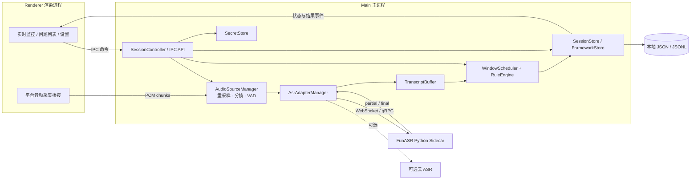
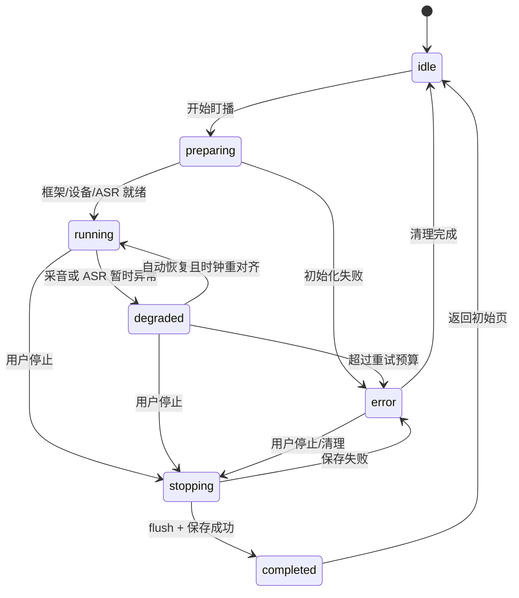

# AI盯播 · 软件设计文档（SDD）

| 字段 | 值 |
|------|-----|
| 版本 | **v0.1.0** |
| 状态 | Baseline（首版技术基线，可随实现修订） |
| 日期 | 2026-10-17（Asia/Shanghai） |
| 对齐需求 | **PRD v0.1.0**（`docs/prd/latest.md`） |
| 适用范围 | 本人自用的 Windows / macOS 桌面 MVP |
| 负责人 | AI盯播项目经理 |

> 工作稿路径：`docs/sdd/latest.md`。版本规则见 `docs/sdd/README.md`；冻结时完整复制到 `docs/sdd/versions/` 并更新 `docs/CHANGELOG.md`。

---

## 1. 文档目的与设计目标

本文把 PRD v0.1.0 落成可实现的桌面技术方案，定义进程边界、模块职责、数据契约、状态机、规则算法、安全边界、测试与验收方法。

设计优先级：

1. **主路径可靠**：系统环回采音 → 流式 ASR → 带时间戳字幕缓冲 → 滑动窗口分析 → 可解释问题列表。
2. **本地优先**：音频、转写、框架和会话默认不出本机；使用云 ASR 时仅发送必需音频与鉴权信息。
3. **规则确定**：MVP 三类问题由可测试规则产生，不让 LLM 自由点评占据主路径。
4. **适配可替换**：ASR 通过稳定接口接入；默认实现可更换，但不把“直播中热切换”作为首版承诺。
5. **异常可降级**：采音或 ASR 中断时明确显示状态并自动重连，不用旧数据伪装实时结果。

非目标：URL 拉流、开播监测、系统通知、公网多用户、企业固证、声学语调/情感分析、应用内框架编辑器、场后报告导出。

## 2. 关键技术决策（ADR 摘要）

| 编号 | 决策 | 选择 | 理由与代价 |
|------|------|------|------------|
| ADR-001 | 应用形态 | Electron + TypeScript + React，桌面单体、多进程隔离 | 符合 PRD；复用桌面与前端生态。代价是安装包和内存开销较大 |
| ADR-002 | 主技术栈 | Electron、Node.js、React、Vite；共享代码使用 TypeScript | 主进程、渲染进程和 ASR 客户端共享类型，降低契约漂移 |
| ADR-003 | 环回采音 | Windows 优先使用 WASAPI loopback 原生桥接；macOS 使用 `desktopCapturer`/`getDisplayMedia` 音频并做系统授权说明 | 不依赖虚拟声卡作为唯一方案；平台差异封装在 `AudioSource` 内 |
| ADR-004 | 音频内部格式 | 单声道、16 kHz、PCM S16LE、20 ms 帧（640 字节） | 便于 VAD、缓冲和 ASR 推送；ASR 所需其他格式只在适配器出口转换 |
| ADR-005 | 默认 ASR | **本地 FunASR 流式服务**，独立 Python sidecar；云 ASR 为第二适配器 | 无按量费用、数据本地、符合自用定位。代价是首启模型下载/加载和打包复杂度 |
| ADR-006 | 进程拓扑 | 主进程负责设备、会话、存储与密钥；sidecar 负责推理；渲染进程只负责 UI 与本地音频采集桥接 | 避免密钥和推理阻塞 UI；采集 API 受限时由平台桥接转入主进程 |
| ADR-007 | 缓冲与时钟 | 单调时钟 `performance.now()` 为分析时钟；UTC ISO 时间为展示时间；所有媒体片段保留首尾时间戳 | 防止系统改时间影响窗口，支持问题回溯 |
| ADR-008 | 分析调度 | 默认每 60 秒分析最近 300 秒；每会话单调度器，快照后串行执行，禁止重入 | 保证默认产品行为；慢规则不会叠加任务 |
| ADR-009 | 数据保存 | MVP 使用会话内存 + 停止时写本地 JSONL 复盘快照 | 解决 PRD 开放问题；崩溃后可诊断，且不引入数据库复杂度 |
| ADR-010 | 密钥 | 优先 OS 安全存储（`keytar`/系统钥匙串）；环境变量仅作开发回退 | 渲染进程永不接触 ASR Key；不写明文配置、不提交仓库 |
| ADR-011 | 框架 | 本地 JSON，启动/加载时 schema 校验，运行时只读快照 | 与 PRD 文件优先一致；避免分析途中文件改变导致结果不可复现 |
| ADR-012 | 框架判定 | 精确关键词 + 规范化匹配为主，中文分词/相似度仅作后置可插拔增强 | MVP 可解释、可复测；避免相似度误判污染主路径 |
| ADR-013 | 问题去重 | 以 `type + frameworkItemId + 规则键` 做指纹，窗口内更新而非无限新增；跨窗设置冷却期 | 满足“无明显问题不刷屏”，同时保留每次触达证据 |

### 2.1 PRD 开放问题的落地结论

1. **默认 ASR**：首版默认本地 FunASR 流式；若目标机器无法承担本地推理，可在“停止盯播”后切换云适配器。MVP 不做直播中带状态热切换，避免丢失上下文。
2. **节奏阈值**：采用第 9.3 节初始阈值，作为配置常量并通过标注样本校准，不散落为魔法数字。
3. **结束落盘**：做最小本地复盘文件；只保存在用户选择或应用默认的本地数据目录，不做导出 UI 和云端同步。

## 3. 总体架构



### 3.1 进程与信任边界

- **Renderer**：不开放 `nodeIntegration`，启用 `contextIsolation`；只通过 `contextBridge` 暴露白名单 API。展示文本一律按纯文本渲染，不注入 HTML。
- **Main**：持有设备管理、框架解析、会话状态、规则引擎、密钥和文件写入权限。所有来自 Renderer 的输入做运行时校验。
- **ASR sidecar**：仅监听 `127.0.0.1` 随机端口；由 Main 创建与回收，使用一次性本地令牌鉴权；异常退出时上报并触发重连，不自动打开公网端口。
- **本地文件**：框架文件只读；复盘文件写入应用数据目录。路径由 Main 校验，禁止 Renderer 传任意写路径。

## 4. 建议代码结构

```text
src/
  main/
    app.ts                    # 生命周期、单实例、窗口创建
    ipc.ts                    # 白名单 IPC 与参数校验
    audio/                    # 设备、环回、重采样、20ms 分帧、VAD
    asr/                      # 接口、FunASR/云适配器、重连
    transcript/               # 时间戳修正、片段合并、环形缓冲
    analysis/                 # 调度、窗口快照、三类规则、去重
    session/                  # 会话状态机、会话存储、JSONL
    framework/                # JSON schema、加载与规范化
    security/                 # SecretStore、日志脱敏
  preload/
    index.ts                  # contextBridge 类型安全 API
  renderer/
    app/                      # 页面与全局会话状态
    features/monitor/         # 字幕、状态、开始/停止
    features/issues/          # 问题列表、角标、证据抽屉
    features/coverage/        # must_say 覆盖勾选
    features/settings/        # 窗口、间隔、ASR 与设备设置
  shared/
    contracts/                # IPC、音频、ASR、框架、领域类型
    config/                   # 默认值与配置约束
python/
  funasr_sidecar/             # 本地流式推理进程
resources/
  models/                     # 可选模型；不作为明文密钥位置
tests/
  fixtures/                   # 脱敏音频、ASR 事件、框架、标注窗
```

## 5. 核心数据契约

以下为逻辑契约；实现时使用 TypeScript 类型 + JSON Schema/Zod 双重校验。时间戳均以会话开始为 `0` 的单调时钟毫秒数，另存 UTC 创建时间用于展示。

### 5.1 音频与 ASR

```ts
type AudioFrame = {
  sessionId: string;
  seq: number;                 // 严格递增，用于发现丢帧
  startMs: number;
  durationMs: 20;
  sampleRate: 16000;
  channels: 1;
  encoding: "pcm_s16le";
  samples: Int16Array;
  rms: number;
  speechProbability?: number;
};

type AsrCapabilities = {
  streaming: true;
  partialResults: boolean;
  wordTimestamps: boolean;
  inputSampleRates: number[];
};

type AsrStartConfig = {
  sessionId: string;
  language: "zh-CN";
  sampleRate: 16000;
  hotwords?: string[];         // 仅使用框架关键词，不传密钥
};

type AsrResult = {
  sessionId: string;
  providerResultId: string;
  startMs: number;
  endMs: number;
  text: string;
  isFinal: boolean;
  confidence?: number;
  words?: Array<{ text: string; startMs: number; endMs: number }>;
};

interface AsrAdapter {
  readonly id: string;
  capabilities(): AsrCapabilities;
  checkHealth(): Promise<{ ok: boolean; detail?: string }>;
  start(config: AsrStartConfig): Promise<void>;
  push(frame: AudioFrame): Promise<void>;
  flush(): Promise<void>;
  stop(): Promise<void>;
  onResult(listener: (result: AsrResult) => void): () => void;
  onError(listener: (error: AsrTransportError) => void): () => void;
}
```

约束：

- Adapter 不得直接操作 UI、框架规则或问题存储。
- `partial` 只更新实时字幕，不进入最终规则判定；对应片段被新 `partial` 替换。
- `final` 以 `providerResultId` 幂等写入；乱序结果按 `startMs` 归位，重复结果忽略。
- Adapter 出口负责字节背压；待发送队列超过 5 秒音频时进入 `degraded` 并记录丢弃区间，禁止静默无限堆积。

### 5.2 转写片段与窗口

```ts
type TranscriptSegment = {
  id: string;
  sessionId: string;
  sourceResultId: string;
  startMs: number;
  endMs: number;
  text: string;
  normalizedText: string;
  isFinal: boolean;
};

type SpeechInterval = { startMs: number; endMs: number };
type SilenceInterval = { startMs: number; endMs: number };

type WindowSnapshot = {
  id: string;
  sessionId: string;
  windowStartMs: number;
  windowEndMs: number;
  triggeredAtMs: number;
  frameworkRevision: string;
  segments: TranscriptSegment[];
  speechIntervals: SpeechInterval[];
  silenceIntervals: SilenceInterval[];
  audioCoverageMs: number;     // 实际收到且未丢失的音频时长
  finalTextCoverageMs: number; // 已有 final 文本覆盖的有效语音时长
};
```

窗口边界采用左闭右开 `[startMs, endMs)`。跨边界片段裁剪到窗口内，并同步裁剪其时间范围；没有词级时间戳时按片段字符比例估算边界，结果标记 `estimatedTiming: true`。

### 5.3 话术框架

兼容 `frameworks/example-framework.v0.json`，最小规则如下：

- 根字段：`id?`、`title?`、`pace`、`must_say[]`、`avoid[]`、`stages[]?`。
- `pace.min/max` 为有限正数且 `min <= max`；`unit` 仅接受 `chars_per_minute`。
- `must_say/avoid` 条目必须有稳定非空 `id`、非空 `text`、至少一个非空 `keywords`。
- 同一文件内条目 ID 不得重复；关键词 trim 后为空则拒绝加载。
- 加载后计算 `frameworkRevision = SHA-256(规范化 JSON)`，问题记录该版本，保证证据可追溯。
- 文件校验失败时不开始盯播，并指出 JSON 路径；不自动忽略坏字段继续运行。

### 5.4 问题与覆盖

```ts
type IssueType = "content" | "pace" | "rhythm";
type IssueSeverity = "info" | "warning" | "critical";

type IssueEvidence = {
  windowStartMs: number;
  windowEndMs: number;
  segmentIds: string[];
  excerpts: Array<{ segmentId: string; text: string; startMs: number; endMs: number }>;
  frameworkItemIds: string[];
  metrics: Record<string, number | string | boolean>;
};

type Issue = {
  id: string;
  sessionId: string;
  fingerprint: string;
  type: IssueType;
  ruleId: string;
  severity: IssueSeverity;
  title: string;
  suggestion?: string;
  firstSeenAtMs: number;
  lastSeenAtMs: number;
  occurrenceCount: number;
  status: "unread" | "read";
  frameworkRevision: string;
  evidence: IssueEvidence;
};

type CoverageItem = {
  frameworkItemId: string;
  covered: boolean;
  firstCoveredAtMs?: number;
  matchedSegmentIds: string[];
};
```

角标只统计当前会话 `status = unread` 的**去重后问题数**；重复命中更新 `occurrenceCount` 和 `lastSeenAtMs`。已读问题只有超出该规则冷却期后再次命中才重新置为未读，冷却期内保持已读；两种情况都不新增列表项。

## 6. 会话状态机与主流程



状态约束：

1. 仅 `running/degraded` 接收音频和 ASR 结果；`preparing` 期间 UI 展示初始化进度。
2. 同一时刻最多一个活动会话；重复点击开始必须幂等。
3. 分析只在 `running` 且有足够音频覆盖时触发；`degraded` 期间不将缺失音频判定为静音。
4. 停止顺序：停止调度器 → 停止采音 → `ASR.flush()` → 等待最终字幕（最多 5 秒）→ 最后一次完整窗口分析（可选且标记 `finalFlush`）→ 写复盘文件 → 释放 sidecar。
5. 停止后保留当前会话只读浏览；新会话开始前不覆盖旧会话数据。

## 7. 模块设计

### 7.1 环回采音与音频管线

`AudioSourceManager` 统一封装平台实现：

1. 枚举可用输出设备及环回能力；未授予权限时给出系统设置指引。
2. 获取设备原始流后重采样为 16 kHz 单声道，转 PCM S16LE。
3. 切分 20 ms 帧，计算 RMS；轻量 VAD 输出语音概率与状态。
4. 同时向 ASR Adapter 和 `AudioTimeline` 推送；ASR 慢时不得反向阻塞 VAD/落时间线。
5. 设备断开、流静音或帧序号跳跃时记录事件；连续 3 秒无帧进入 `degraded`，指数退避重连（1/2/4/8 秒，最多 5 次）。
6. 重连后开启新的连续音频区间，不用插零补齐未知声音，避免把采音中断算成“超长停顿”。

平台回退顺序：原生 WASAPI loopback（Windows）→ Electron 桌面音频能力 → 明确提示用户使用系统支持的环回设备。MVP 不自动安装虚拟声卡，不宣称所有 macOS 版本无配置可用。

### 7.2 ASR 适配与本地 sidecar

默认 FunASR 适配器负责：

- 启动前健康检查：Python/打包运行时可执行、模型存在、端口可监听、推理自测通过。
- 将 PCM 帧通过本地 WebSocket 发送；协议消息包含 `sessionId`、单调序列、相对时间和 PCM 二进制帧。
- 将 sidecar 结果统一映射为 `AsrResult`，不向上泄露 FunASR 特有字段。
- 维护有限队列与 5 秒背压阈值；超时、断连和进程退出统一转换为领域错误。
- 重连时仅恢复新音频，不假定旧 partial 已生效；已向用户展示重连期间的字幕缺口。

模型下载是显式首次设置步骤，显示大小、进度与失败原因；模型文件不包含在源码仓库。MVP 可先支持 CPU，后续再按平台增加 GPU 后端，不让硬件差异改变上层接口。

### 7.3 TranscriptBuffer

- 采用按会话增长的内存数组 + 时间索引，常规目标为单场 2 小时；MVP 不设置 2 小时硬上限，更长直播继续保留 final 文本到停止，窗口查询只取近 5 分钟，并纳入长时间容量测试。
- 保存 final 片段、当前 partial、音频连续区间、VAD 语音/静音区间和缺口区间。
- `snapshot(endMs, windowMs)` 必须返回不可变副本；规则引擎不得读取仍在变化的实时数组。
- 文本规范化只做：去首尾空白、全角转半角、英文小写、统一连续空白、移除常见 ASR 标点；原 `text` 永远保留用于展示证据。
- 中文字数统计使用 Unicode 码点；剔除标点、空白和纯语气/重复 ASR 碎片后才计入有效字数，剔除规则集中配置并纳入单测。

### 7.4 WindowScheduler

- 默认 `windowMs = 300_000`、`intervalMs = 60_000`；设置约束 `windowMs ∈ [60_000, 900_000]`，`intervalMs ∈ [15_000, 300_000]`。
- 会话开始后的首个完整分析窗口到达时才常规触发；为便于调试可提供开发模式缩短参数，不改变生产默认值。
- 若上一轮仍在运行，则跳过本轮并记录 `analysis_overrun`；绝不并行堆积。
- 每次分析记录调度延迟、窗口音频覆盖、规则耗时、ASR final 覆盖，支持验收与性能定位。

## 8. 规则引擎总设计

`RuleEngine.analyze(snapshot, framework, previousState)` 为无副作用函数，输出 `IssueCandidate[]` 与 `CoverageItem[]`；存储层负责幂等合并。

### 8.1 分析门槛

为避免无数据时误报：

- `audioCoverageMs / windowDurationMs < 0.8`：不产出语速或节奏问题，生成内部数据质量事件。
- 有效语音时长 `< 15 秒`：不判定语速过慢/过快，也不判定节奏；避免开场短暂安静刷屏。
- final 文本有效覆盖 `< 60%`：内容规则只报告已命中的 `avoid`，不报告 `must_say` 漏讲；标记 ASR 覆盖不足。
- `avoid` 命中属于明确风险，可在满足最小文本置信条件时优先报告，不受漏讲门槛限制。

所有被抑制的候选都写诊断日志，但不进入用户问题列表。

### 8.2 通用匹配规则

1. 关键词与转写使用相同规范化函数。
2. 单字关键词必须按词边界或自定义词典匹配，避免误命中；多字中文短语允许子串匹配。
3. 匹配证据记录原始片段 ID、原文、命中关键词和时间。
4. 同一关键词在同窗口多次命中只产生一条候选，证据最多保留 3 个代表片段。
5. `must_say` 覆盖采用**当前分析窗口覆盖**驱动漏讲提示；另维护**本场累计覆盖**驱动讲点勾选，两者不能混用。

## 9. 三类问题的具体算法

### 9.1 内容规则（最高优先级）

#### A. `avoid` 触雷

- 对窗口 final 文本执行关键词匹配。
- 命中任一 `avoid[i].keywords` 即生成 `content.avoid_hit`，`severity = critical`。
- `frameworkItemIds = [avoid[i].id]`；建议为“停止相关表述，改用合规、可验证的描述”。
- 指纹：`content:avoid:<itemId>`；冷却 3 分钟。冷却内重复命中更新原问题，不新增。

#### B. `must_say` 近窗漏讲

- 先计算每个条目在当前窗口是否命中至少一个关键词。
- 仅对**本场已经连续两个完整分析窗口未覆盖**的条目生成 `content.must_say_missing`，降低偶发误报。
- 同窗口多个漏讲条目合并为一条问题，标题为“近窗有 N 个必讲点未覆盖”，证据列出所有条目与近窗代表文本。
- 建议按条目生成“补充：{text}”；条目过多时只展示前 3 个建议，其余在详情中查看。
- 指纹：`content:must_say_missing`；集合变化时更新证据，不反复新增。
- 例外：开播首个窗口不直接报漏讲，需满足连续两个窗口门槛。

#### C. 跑题

MVP 不开放自由语义跑题规则。仅保留后置 `keyword_similarity` 实验接口，默认关闭，不能阻塞 Must 验收。

### 9.2 语速规则

定义：

- `effectiveChars`：窗口 final 文本去标点/空白后的有效字符数；按语音区间裁剪重复片段，避免 overlapping ASR 结果重复计数。
- `effectiveSpeechMs`：VAD 语音区间与有 final 文本覆盖区间的**交集**时长；排除采音缺口和静音，避免无识别文本的语音区间压低语速。
- `charsPerMinute = effectiveChars / (effectiveSpeechMs / 60000)`。

判定：

- `charsPerMinute < pace.min` → `pace.too_slow`，建议“适当加快，减少无效重复”。
- `charsPerMinute > pace.max` → `pace.too_fast`，建议“放慢语速，在卖点和行动号召后停顿”。
- 偏差不足阈值 10% 时为 `info`，超过 10% 为 `warning`；MVP 不设 `critical` 语速问题。
- 只有满足第 8.1 节数据门槛才产出；证据必须含有效字数、有效秒数、实际字/分钟、配置上下限。
- 指纹：`pace:too_slow` 或 `pace:too_fast`；冷却 5 分钟，方向变化可立即生成对应方向的问题。

> 注意：字/有效语音分钟会比“字/墙上时钟分钟”高，这是有意的，避免正常停顿被算作语速慢。节奏由独立规则判断。

### 9.3 节奏规则

默认阈值集中在 `RhythmRuleConfig`：

| 参数 | 默认值 | 含义 |
|------|--------|------|
| `longSilenceMs` | 4,000 ms | 语音期间无语音持续达到该值为超长停顿 |
| `highSilenceRatio` | 0.45 | 有效音频窗口内静音占比过高 |
| `highSpeechRatio` | 0.92 | 语音占比过高，且窗口内长停顿次数为 0 |
| `minDenseSpeechMs` | 60,000 ms | 判断“连珠炮”至少需要连续/近连续语音 60 秒 |
| `maxSentenceGapMs` | 1,200 ms | 估算句边界所使用的句间停顿 |
| `minSentenceLengthChars` | 4 | 低于此长度的碎片不参与句密度 |

规则：

1. **超长停顿**：存在单个 `SilenceInterval >= longSilenceMs`，且该区间不属于采音缺口，生成 `rhythm.long_pause`；证据给最长停顿秒数与前后片段。
2. **静音占比高**：窗口静音占比 `> highSilenceRatio` 且语音时长达到 15 秒，生成 `rhythm.low_density`；建议“缩短空场，补充卖点或互动”。
3. **连珠炮**：语音占比 `> highSpeechRatio`、有效语音累计 `>= minDenseSpeechMs`、无 `>= maxSentenceGapMs` 的句间停顿，且语速不低于 `pace.min`，生成 `rhythm.no_pause`；建议“在重点后留 1–2 秒停顿”。
4. 句密度仅作为诊断指标和后续校准依据；首版不因单独“句密度高/低”发问题，避免与语速重复报警。
5. 同一节奏规则冷却 5 分钟；不同规则可并存，但同窗口最多展示一个最高优先级节奏问题，优先级 `long_pause > low_density > no_pause`。

## 10. 去重、角标与建议动作

- 新问题默认 `unread`，写入后 Renderer 更新角标并插入列表顶部。
- 用户打开问题详情或点击“标为已读”只改变状态，不删除证据。
- 冷却期从 `lastSeenAtMs` 起算；持续存在的问题更新原记录，不每轮新增。
- 列表默认按 `critical > warning > info`，再按 `lastSeenAtMs` 倒序；当前会话结束后可浏览全部记录。
- 建议动作来自规则模板，不调用 LLM：内容补讲/停止触雷、语速加快/放慢、节奏停顿/补充内容。
- 若连续 3 个窗口只有数据质量不足，不创建“讲偏”问题，只在状态区提示“音频或识别质量不足”。

## 11. IPC 与 UI 契约

### 11.1 命令与事件

| 通道 | 方向 | 用途 |
|------|------|------|
| `framework:select/load` | Renderer → Main | 选择并校验本地框架，返回元数据与 revision |
| `audio:listDevices` | Renderer → Main | 返回可用环回设备与权限状态 |
| `session:start/stop` | Renderer → Main | 幂等控制会话，返回会话快照 |
| `session:stateChanged` | Main → Renderer | `preparing/running/degraded/...` 与错误详情 |
| `transcript:partial/final` | Main → Renderer | 实时字幕增量 |
| `analysis:issuesUpdated` | Main → Renderer | 新增/合并后的问题与未读数 |
| `analysis:coverageUpdated` | Main → Renderer | 本场累计覆盖勾选 |
| `issue:markRead` | Renderer → Main | 标记单条或全部已读 |
| `settings:get/update` | 双向 | 读取/校验窗口、间隔和 ASR 选择 |

preload 只暴露封装方法，不暴露通用 `ipcRenderer.invoke/send`，避免任意通道调用。

### 11.2 页面与状态展示

- **准备区**：框架名/revision、环回设备、ASR 实现与健康状态、开始按钮。
- **监控区**：连接状态、已运行时长、最近分析时间、实时字幕；数据缺口以状态提示而非伪造字幕。
- **问题区**：未读角标、类型/严重度筛选、问题卡片、证据抽屉；证据含时间窗、原文片段、框架条目和关键指标。
- **覆盖区**：`must_say` 本场累计已讲/未讲；与近窗漏讲问题并列但语义明确区分。
- **设置区**：窗口时长、分析间隔、ASR 选择和密钥设置；活动会话期间禁用需要重建管线的设置。

## 12. 本地存储与复盘文件

### 12.1 存储策略

- 活动数据：内存 `SessionAggregate`，包含配置快照、框架快照、音频缺口、final 字幕、问题与覆盖。
- 应用设置：Main 写入应用数据目录的普通 JSON；只含非敏感配置。
- ASR Key：OS 安全存储；环境变量仅开发模式读取。日志、IPC 返回值、复盘文件均不得包含密钥。
- 停止盯播：写入 `sessions/<sessionId>/session.jsonl`，目录权限按当前用户私有设置。

### 12.2 JSONL 事件格式

首行为 `session_started`，随后按顺序记录 `framework_loaded`、`transcript_final`、`audio_gap`、`analysis_completed`、`issue_upserted`、`session_stopped`。每条事件包含 `schemaVersion`、`sessionId`、`recordedAt` 和 `payload`。

- 不保存原始音频，降低隐私与磁盘成本。
- 文件用于 MVP 后浏览/诊断，不做应用内报告导出；若写盘失败，保留内存会话并明确提示。
- 文本可能包含直播内容，不自动上传；日志默认不记录完整转写，只记录片段 ID 和统计值。

## 13. 错误处理、可靠性与可观测性

| 场景 | 检测 | 用户表现 | 系统动作 |
|------|------|----------|----------|
| 框架 JSON 非法 | schema 校验失败 | 显示字段路径，禁止开始 | 不创建会话 |
| 无环回权限/设备 | 打开流失败 | 展示授权/设备指引 | 可重试，不进入 running |
| ASR 初始化失败 | 健康检查/超时 | 显示具体适配器错误 | 清理 sidecar，允许更换实现 |
| ASR 中途断连 | socket/进程错误 | `degraded`，标记字幕缺口 | 有预算重连；失败转 error |
| 采音中断 | 3 秒无帧/设备事件 | 显示采音中断 | 重建音频流，缺口不做节奏判定 |
| 分析超时 | 单轮 > 10 秒 | 不阻塞字幕 | 终止本轮、记录指标、下轮重试 |
| 写复盘失败 | 文件 I/O 错误 | 停止后明确警告 | 保留内存数据，不假装已保存 |

日志采用分级结构化格式，包含 `sessionId`、模块、事件、耗时、错误码；默认保留最近 7 天或 50 MB，密钥、完整音频、完整转写、令牌全部脱敏。

## 14. 性能与容量目标

| 指标 | MVP 目标 | 测量方式 |
|------|----------|----------|
| 连续运行 | ≥30 分钟不断采、不断字；目标扩展到 2 小时 | 30 分钟/2 小时 soak 测试，核对帧与 final 连续性 |
| 实时字幕延迟 | 本地推理正常负载下，语音结束到 partial 通常 ≤2 秒 | 音频注入时间戳与 UI 事件对比 |
| 分析触发 | 每 60 秒 ±2 秒触发（无 overrun） | 调度日志 |
| 规则计算 | 单窗口 P95 < 500 ms | 规则性能测试 |
| 问题可见 | 满足条件后下一轮分析完成 ≤2 秒出现在列表 | 集成测试 |
| 音频队列 | 不超过 5 秒待发送音频；超限显式降级 | 背压故障注入 |
| UI 响应 | 转写高频更新不阻塞交互；列表渲染批量提交 | 30 分钟 UI 性能记录 |

PRD 的“约 1～2 分钟内可见新问题”由默认 60 秒调度满足；首次漏讲因双窗口确认，通常需要更长时间，这是降低误报的有意设计，验收用例需据此构造。

## 15. 安全与隐私

1. Renderer 沙箱化、禁用 Node 集成、启用上下文隔离；导航与外链采用白名单。
2. 所有 IPC 参数校验类型、范围和路径；不信任 Renderer 传入的文件写路径。
3. ASR 密钥只在 Main 读取并直接交给对应适配器；不进入 React 状态、URL、日志、复盘文件。
4. sidecar 仅绑定 loopback，使用一次性令牌，父进程退出时强制回收。
5. 本地复盘只保存文本与事件，不保存原始音频；提供“清除本地会话数据”的后置能力，MVP 至少允许用户手动定位目录。
6. 云 ASR 启用前明确提示音频将发送到对应服务；默认本地适配器不发公网请求，模型下载除外。
7. 第三方依赖生成锁文件；模型与安装包记录来源和校验值，仓库忽略密钥、模型缓存和真实会话文本。

## 16. 测试策略

### 16.1 单元测试

- 文本规范化、有效中文字数、重复片段去重。
- 窗口裁剪、跨边界片段、partial/final 替换、乱序/重复 ASR 结果。
- 语速公式与上下限、有效语音时长、数据不足抑制。
- 三类节奏阈值、采音缺口不误判静音。
- `must_say` 当前窗口覆盖与本场累计覆盖的语义差异、双窗口漏讲。
- `avoid` 命中、证据完整、指纹合并、冷却和未读角标。
- 框架 schema、配置边界、IPC 非法参数。

### 16.2 集成测试

使用可回放的 PCM 和确定性 Fake ASR，不依赖真实模型：

1. 音频注入 → ASR 事件 → 缓冲 → 调度 → 规则 → IPC → UI 全链路。
2. 默认 5 分钟窗、1 分钟间隔，核对每次快照范围与触发次数。
3. 断连/重连、背压、停止 flush、重复开始/停止。
4. 停止后 JSONL 可重新载入为只读会话，问题证据与内存一致。
5. FunASR 契约测试：样例音频与固定结果映射；模型准确率单独评估，不让波动模型导致所有测试不稳定。

### 16.3 端到端与人工验收

- Windows 实机环回播放预录直播音频，macOS 按支持矩阵单独验收。
- 30 分钟包含正常讲解、快/慢语速、长停顿、触雷、漏讲和静音的混合样本。
- 抽 10 个问题窗人工判断，至少 7 个“确实该改”；同时记录误报原因并只通过阈值/规则修订校准。
- 无明显问题样本不连续刷屏；重复问题合并，角标等于未读去重问题数。

## 17. PRD 验收映射

| PRD 验收项 | 技术实现 | 验证证据 |
|------------|----------|----------|
| 连续 ≥30 分钟不断采、不断字 | 有界音频队列、背压降级、自动重连、sidecar 健康检查 | soak 日志、音频缺口事件、final 字幕连续性 |
| 问题对应时间窗 + 转写片段 + 框架条目 | `IssueEvidence` 强制字段、framework revision、不可变窗口快照 | 类型测试、UI 证据抽屉、JSONL 对照 |
| 10 个问题窗至少 7 个有效 | 确定性规则、数据质量门槛、双窗口漏讲、去重冷却 | 标注样本与人工抽检记录 |
| 分析后约 1～2 分钟可见 | 默认 60 秒调度、串行规则、分析后即时 IPC | 调度与 UI 时间戳；漏讲双窗口例外有明确用例 |
| 无明显问题不刷屏；角标=未读数 | 指纹幂等、冷却、问题合并、未读状态 | 重复事件集成测试与 UI 测试 |

## 18. 分阶段交付计划

### M1：底座

- Electron 安全基线、React 壳、共享契约。
- Windows 环回设备与 PCM 管线；macOS 能力验证单独列风险。
- FunASR sidecar、默认 ASR Adapter、Fake ASR。
- 实时 partial/final 字幕、TranscriptBuffer、30 分钟 soak。

**退出标准**：固定音频可稳定出字；真实环回连续 30 分钟；断连有明确状态。

### M2：分析

- 框架加载与 schema 校验、不可变窗口快照。
- 内容/语速/节奏规则、证据、去重与冷却。
- 问题列表、未读角标、证据抽屉、设置窗口与间隔。

**退出标准**：PRD Must 全链路通过，规则单测覆盖关键边界，10 窗人工抽检可执行。

### M3：打磨

- 建议动作、本场累计讲点勾选、密钥安全存储、基础设置页。
- 停止 flush、JSONL 复盘、错误恢复、性能优化与安装包验证。

**退出标准**：Should 项完成或有明确砍项记录；MVP 验收全部有证据。

## 19. 风险与回退方案

| 风险 | 影响 | 缓解/回退 |
|------|------|-----------|
| macOS 系统环回受权限和版本限制 | 跨平台能力不一致 | 先公布 Windows 首验；macOS 使用支持矩阵和明确回退，不虚假承诺 |
| 本地 FunASR 在低端机延迟高 | 字幕和提示滞后 | 队列降级、降低模型规格；停止后切云 ASR；不改变分析接口 |
| VAD 在背景音乐/直播间效果音下误判 | 语速、节奏偏差 | 将音乐场景纳入标注；阈值配置化；数据不足时抑制而非强报 |
| ASR 无准确词级时间戳 | 窗口字数和片段边界误差 | 使用 final 句级时间戳与估算标记；优先保证 avoid 和覆盖，谨慎报节奏 |
| `must_say` 近窗漏讲天然易重复 | 打扰主播 | 双窗口确认、合并条目、冷却、已读状态；后续按 stages 增强 |
| 复盘文本涉及隐私 | 本地泄露风险 | 默认本地、私有目录、不存音频、不记完整文本日志、不上传 |

## 20. 后续演进但不进入本 MVP

- 基于 `stages[]` 的阶段识别和阶段性必讲规则。
- 可插拔语义相似度/LLM 复核，只能作为规则后的可选增强，必须保留证据与确定性回退。
- GPU 推理、更多云 ASR、直播中无状态损失的热切换。
- 复盘报告 UI、应用内框架编辑器、系统通知、声学与情感分析。

---

## 修订记录

| 版本 | 日期 | 说明 |
|------|------|------|
| v0.1.0 | 2026-10-17 | 首版技术基线：进程架构、默认 FunASR、环回音频管线、数据契约、三类规则、存储安全、测试验收与交付计划 |
